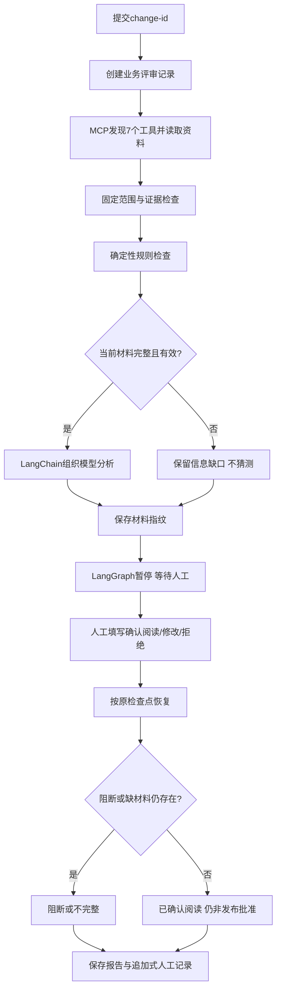

# 发布风险评审助手：先理解，再看代码

## 1. 它解决什么问题

**发布**是把一个软件版本或配置投入运行。**评审**是在操作前检查材料、找出风险、由人复核。这个项目帮助回答：“这次准备发布的改动，有哪些值得先核实的风险？”

例如订单服务准备把连接池上限从50改成5。**数据库**保存订单等业务数据；**连接池**是程序提前建立、反复使用的一组数据库通信连接。可用连接不够时，请求可能排队。新助手在发布前发现这个变化，要求负载和容量验证；旧助手则在出现故障后调查原因。

**Agent，智能体**，在本项目中是一套把资料、模型分析、固定规则和人工复核组织起来的助手程序。它是一种工作流型助手：程序安排固定取证，模型补充风险解释，不是让模型任意决定发布。

当前代码可以独立运行，旧项目保持不变。业务数据来自本地模拟记录，没有连接真实企业代码仓库、测试流水线或生产数据库。

## 2. 这次真正新用了什么

| 名称 | 首次解释 | 项目中的实际工作 |
|---|---|---|
| MCP，模型上下文协议 | 让应用用统一方式发现和调用外部能力的协议 | 客户端连接FastMCP服务对象，发现并调用7个只读工具 |
| FastMCP | 编写MCP工具服务的Python库；Python是本项目使用的编程语言 | 声明7个工具的名字、输入及真实读取代码 |
| LangChain | 组织模型输入、工具接口和结果处理的开发框架 | 通过MCPAdapter适配工具，用提示模板与结构化模型组成分析链 |
| LangGraph | 把任务分成有状态节点、能保存和继续的工作流框架 | 按节点取证、查规则、分析、暂停等人、完成记录 |
| Redis | 主要在内存中保存数据的独立服务 | 可选的跨进程缓存、临时锁和排队任务 |
| SQLite | 用本地文件保存和查询数据的数据库 | 分别保存工作流检查点和业务审核记录 |
| Pydantic | 检查数据字段、类型和长度的Python库 | 约束模型分析结构，拒绝额外的“批准发布”字段 |

**工具**也叫本项目的Skill，即事先实现的一项固定能力。它们是Python函数，不是下载的技能包。**MCPAdapter**把通过MCP发现的工具转换成LangChain可以调用的工具对象。

注意三个层次不同：MCP解决怎么连接；LangChain解决怎么组织模型与工具接口；LangGraph解决整个流程怎样执行、暂停和继续。Redis解决临时协调与缓存，不负责决定能否发布。

默认演示真实使用上述MCP、LangChain与LangGraph库，但把远端模型替换成明确标注的固定脚本；Redis则需显式选择，默认本地内存不是Redis。

## 3. 有几个Agent，哪些只是普通节点

本项目只有**一个业务角色：发布风险分析助手**。它使用Qwen模型服务生成风险解释。**Qwen**是模型系列，默认模型名是`qwen3.8-flash`；**API**是程序联系模型服务、提交问题并取得回复的接口。

程序有5个工作节点。**节点**是一段负责某个步骤的代码，不等于一套独立模型：

1. `collect`：收集材料。
2. `policy`：执行确定性规则。
3. `model_review`：调用模型辅助分析。
4. `human_review`：暂停，等待人填写意见。
5. `finish`：记录最终状态。

其中只有模型分析节点调用语言模型；另外四个是普通程序或人工输入。不要在简历里把5个节点写成5个Agent。

**提示词**是给模型的任务说明。模型必须基于本次证据提出待验证风险、信息缺口及检查项，不得删除程序规则结果，不得宣布已经批准发布。

## 4. 完整流程图

**change-id**是本次变更的编号；**review-id**是本次评审的编号。一次变更可以重新提交多次评审，但同一评审不能偷偷更换变更或演示/真实模式。

## 5. 七个工具，各拿什么材料

| 工具 | 白话含义 | 返回材料 |
|---|---|---|
| get_release_snapshot | 查看待发布版本快照；快照指某时点保存的状态 | 版本、前版本、副本数量、评审时间 |
| get_config_diff | 查看配置差异；差异指修改前后对比 | 连接池上限等配置变化 |
| get_code_diff | 查看代码差异 | 本次修改的模拟文件及摘要 |
| get_ci_checks | 查看自动测试结果；CI指代码提交后自动运行检查的流程 | 明确通过、失败或缺少记录 |
| get_dependency_budget | 查看依赖容量预算；依赖是本服务需要使用的其他系统 | 目标总连接需求、数据库可用余量 |
| search_runbooks | 查询运行手册；手册是人工整理的检查与操作参考 | 适用服务和事件时间的手册 |
| search_incident_cases | 查询历史事故案例 | 同服务、同环境且人工确认的经验 |

每个工具都必须指定change-id。查询手册和案例还要给查询词。代码不提供“任意读取文件”“任意执行命令”或“任意连接网站”的工具。

当前一次图运行固定查询这7项；工具发现和调用走真正MCP，不是用普通函数冒充，但不是让模型自由选择下一项工具。这与旧项目的自主工具选择循环不同。

## 6. 用risk-pool案例读懂规则

**确定性规则**是相同输入下按代码得到相同结果的检查，不靠模型自由判断。**blocker，阻断项**表示存在不能被一句“已阅读”消除的问题；**warning，警告**表示还需核查。

本例有两个相互独立的检查：

1. 连接池上限50→5，下降90%，命中“至少下降50%”警告。它是风险线索，不直接证明一定会故障。
2. 目标8份运行实例，每份允许5条连接，总需求40。数据库上限200，其他使用者已占180，可用预算20。40大于20，命中容量阻断。

**实例**是一份正在运行的服务程序；这里的“其他使用者”明确不含本次目标实例，避免把同一需求算两遍。

另外，明确的CI失败会产生阻断；缺CI记录或容量记录只记缺材料，不编造“测试失败”或“容量一定不足”。

模型分析存放在另一个字段，不能通过自己的回答删除或降级这些规则。人工确认也不能覆盖blocker。

## 7. LangChain具体做了什么

`analysis.py`实际构造“提示模板→结构化模型”的分析链。**模板**是留有scope、证据和规则结果位置的任务说明；**结构化输出**是按固定字段返回内容，方便程序检查。

真实模式使用`ChatOpenAI`这个兼容模型接口的适配类连接配置的Qwen地址；类名带OpenAI不代表实际请求了OpenAI模型。

返回内容包括概述、风险候选、待验证方法、缺失材料和流程问题。**Pydantic**检查字段与数量；证据编号还要属于本次实际材料，并至少包含当前变更资料，不能只靠旧手册判断今天的风险。

**JSON**是按字段组织数据的文本格式。模型接口的JSON模式帮助得到可解析数据，但不保证字段规则或事实正确。因此还要做本地检查。**Schema**指字段、类型、数量和长度的结构规则。

演示模式使用LangChain的`RunnableLambda`：把固定脚本包装为同一种可执行链，并接受相同结果检查。它不是一次真实模型推理。真实模式先请求一次；仅当质量问题全部为`historical_only_risk`，即当前风险只有历史引用时，允许再生成一次。网络失败、越权、未知引用等不触发重生成，两次共享配置中的总异步等待预算，失败仍保留不完整状态。

这次重生成沿用同一范围、证据与规则，不调用工具；可以返回空风险列表，把历史建议放进流程待核查项，不能机械补上当前证据编号。每次调用记录各自用量和问题，最后一次必须重新通过完整检查；人工暂停和规则阻断不改变。

## 8. LangGraph具体做了什么

**状态**是当前任务已经知道或完成的信息，例如scope、证据、规则、模型分析和人工意见。**检查点**是把当前工作进度保存下来，以便以后继续。

`StateGraph`声明5个节点的连接关系；`AsyncSqliteSaver`把检查点写进本地SQLite；`interrupt()`在人工节点暂停；`Command(resume=...)`带回人工输入继续运行。这些都是框架真实接口，不是手写同名类。

暂停后可以关闭程序，再运行resume。从检查点继续时，不需要重新调用模型或重新取证。进程在自动节点之间中断，可用retry继续未完成的节点，不能把“还有节点没执行”误当成“已经等人工”。

**材料指纹**是把本次范围、完整证据、规则和已检查模型结果计算成固定摘要字符串，用来发现材料变化。它不是签名，不证明谁操作。人工输入绑定这份指纹，不能把对一份材料的意见套给另一份。

## 9. Redis、业务库和检查点各管什么

**缓存**是临时保存可重复使用的查询结果。缓存键绑定数据文件内容指纹、范围、工具和参数，避免材料改了还用旧结果。

**临时锁**限制同一评审的同时处理；锁有所有者令牌和有效期，释放时必须原子检查所有者。**原子**指检查和修改不能被其他操作插到中间。但锁过期、进程退出仍可能造成重试，不能只靠锁承诺业务不重复。

**Redis Streams，消息流**，用于把变更任务排队。**消费组**把任务交给处理程序；处理后用ack确认；程序退出前没确认的任务会进入待处理记录，过期后可重领。

Redis不是人工意见的唯一保存处。业务库`reviews.sqlite3`保留评审、事件及只能追加的人工记录；检查点库`checkpoints.sqlite`保留图进度。两份库不在同一个事务里，采用稳定人审编号做恢复对账，不宣称跨库“恰好一次”。

**幂等**指相同操作重复执行不会重复产生同样的业务效果。这里已有评审复用、稳定人审编号和已完成流程检查，减少重投重复；不意味着所有网络异常下都不会再次读取或调用模型。

## 10. 如何复用旧项目

新项目只读旧报告JSON，导入为本地历史候选；默认未审核。旧报告complete=true只是通过旧程序检查，不是新项目的人工确认。

审核后显式使用`--confirmed`导入才可检索。只匹配同服务和环境；旧demo案例不能自动用于staging，所以提供legacy-demo案例演示对接。

导入内容保存新目录；不读取旧settings密钥、不改旧报告，也不改变旧案例审核状态。历史经验可提示要查什么，不能独自证明本次一定存在同样问题。

## 11. 文件和责任

| 文件 | 做什么 |
|---|---|
| run.py / cli.py | 命令行入口、提交/恢复/重试/排队、业务记录衔接 |
| config.py / settings.py | 读取模型地址及用户填写的密钥，检查配置 |
| evidence.py | 读取固定模拟资料、验证范围和证据、过滤手册与案例 |
| mcp_server.py | 向MCP客户端提供7个只读工具 |
| mcp_client.py | 真实发现并调用工具，缓存成功结果 |
| policy.py | 产生不能被模型覆盖的规则结果 |
| analysis.py | LangChain模型链、演示脚本和分析结构检查 |
| workflow.py | LangGraph节点、检查点、人审暂停与恢复 |
| coordination.py | 明确区分本地与Redis的缓存、锁和队列 |
| storage.py | 业务评审、事件和追加式人工记录 |
| legacy.py | 把旧报告只读导入为待确认历史候选 |
| reporting.py | 输出可读报告及JSON，不把确认阅读写成发布批准 |
| tests/ | 自动验证协议、规则、状态、恢复和异常分支 |

**自动化测试**是程序对预定输入检查结果，不是拿多个真实事故测模型准确率。测试数量和本次实际运行见05文档。

## 12. 与原设计的边界及实现效果

完成：真实MCP进程内协议、真实LangChain链、真实LangGraph暂停与持久恢复、Redis客户端代码及模拟测试、旧报告导入、规则阻断、人工记录与完整报告。

在线观察：用户的`qwen-safe-lh-001`已取得真实Qwen返回，7个MCP工具成功，模型调用记录14.441659秒、1625输入/542输出/2167总token；但`analysis.risks[1]`仅引历史资料而被拦，`analysis=null`、`waiting_human`。这是接口返回及质量拦截记录，不是有效在线评审报告或稳定时延基准。

未验证：通过全部检查的在线模型报告、本次有限重生成的在线效果、真实Redis服务与跨主机故障恢复、受限制的独立进程MCP。独立进程服务入口已经提供，不把未跑过的模式算作通过。

未实现：真实Git/CI/监控连接器、Java/Spring Boot后台、MySQL、生产发布执行器、模型训练。之前方案中的这些扩展没有被混入本版简历成果。

## 13. 面试中怎样介绍

> 我在故障诊断项目之外，实现一个发布前风险评审助手。它通过MCP统一取发布、配置、测试与容量证据，使用LangChain组织结构化模型分析，使用LangGraph保存进度并暂停等待人工。规则结果与模型分析分开，确认阅读不能覆盖阻断项。Redis提供缓存、锁和任务排队，SQLite保存审核事实。模拟流程已验证；真实Qwen曾返回，但历史引用不足的风险被本地检查拒绝，尚无有效在线报告。真实Redis服务尚未验证，不执行生产发布。

详细启动命令见项目README；工具、存储、框架各自的实现细节和问答分别见02、03、04文档。
