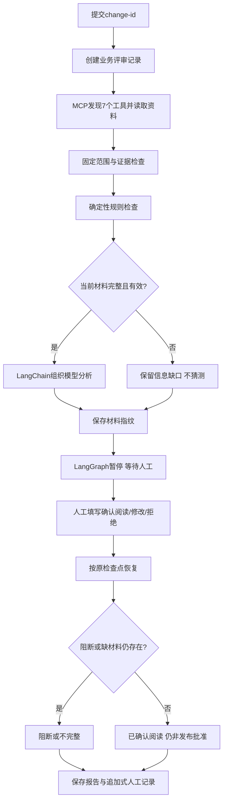

# 发布风险评审助手：项目详解与面试合订版

以实际代码与实验为准；真实Qwen已有被质量检查拒绝的返回记录，尚无有效在线模型报告；真实Redis服务仍未验证，新增有界重生成的在线效果另待复验。

---

## 发布风险评审助手：先理解，再看代码

### 1. 它解决什么问题

**发布**是把一个软件版本或配置投入运行。**评审**是在操作前检查材料、找出风险、由人复核。这个项目帮助回答：“这次准备发布的改动，有哪些值得先核实的风险？”

例如订单服务准备把连接池上限从50改成5。**数据库**保存订单等业务数据；**连接池**是程序提前建立、反复使用的一组数据库通信连接。可用连接不够时，请求可能排队。新助手在发布前发现这个变化，要求负载和容量验证；旧助手则在出现故障后调查原因。

**Agent，智能体**，在本项目中是一套把资料、模型分析、固定规则和人工复核组织起来的助手程序。它是一种工作流型助手：程序安排固定取证，模型补充风险解释，不是让模型任意决定发布。

当前代码可以独立运行，旧项目保持不变。业务数据来自本地模拟记录，没有连接真实企业代码仓库、测试流水线或生产数据库。

### 2. 这次真正新用了什么

| 名称 | 首次解释 | 项目中的实际工作 |
|---|---|---|
| MCP，模型上下文协议 | 让应用用统一方式发现和调用外部能力的协议 | 客户端连接FastMCP服务对象，发现并调用7个只读工具 |
| FastMCP | 编写MCP工具服务的Python库；Python是本项目使用的编程语言 | 声明7个工具的名字、输入及真实读取代码 |
| LangChain | 组织模型输入、工具接口和结果处理的开发框架 | 通过MCPAdapter适配工具，用提示模板与结构化模型组成分析链 |
| LangGraph | 把任务分成有状态节点、能保存和继续的工作流框架 | 按节点取证、查规则、分析、暂停等人、完成记录 |
| Redis | 主要在内存中保存数据的独立服务 | 可选的跨进程缓存、临时锁和排队任务 |
| SQLite | 用本地文件保存和查询数据的数据库 | 分别保存工作流检查点和业务审核记录 |
| Pydantic | 检查数据字段、类型和长度的Python库 | 约束模型分析结构，拒绝额外的“批准发布”字段 |

**工具**也叫本项目的Skill，即事先实现的一项固定能力。它们是Python函数，不是下载的技能包。**MCPAdapter**把通过MCP发现的工具转换成LangChain可以调用的工具对象。

注意三个层次不同：MCP解决怎么连接；LangChain解决怎么组织模型与工具接口；LangGraph解决整个流程怎样执行、暂停和继续。Redis解决临时协调与缓存，不负责决定能否发布。

默认演示真实使用上述MCP、LangChain与LangGraph库，但把远端模型替换成明确标注的固定脚本；Redis则需显式选择，默认本地内存不是Redis。

### 3. 有几个Agent，哪些只是普通节点

本项目只有**一个业务角色：发布风险分析助手**。它使用Qwen模型服务生成风险解释。**Qwen**是模型系列，默认模型名是`qwen3.8-flash`；**API**是程序联系模型服务、提交问题并取得回复的接口。

程序有5个工作节点。**节点**是一段负责某个步骤的代码，不等于一套独立模型：

1. `collect`：收集材料。
2. `policy`：执行确定性规则。
3. `model_review`：调用模型辅助分析。
4. `human_review`：暂停，等待人填写意见。
5. `finish`：记录最终状态。

其中只有模型分析节点调用语言模型；另外四个是普通程序或人工输入。不要在简历里把5个节点写成5个Agent。

**提示词**是给模型的任务说明。模型必须基于本次证据提出待验证风险、信息缺口及检查项，不得删除程序规则结果，不得宣布已经批准发布。

### 4. 完整流程图



**change-id**是本次变更的编号；**review-id**是本次评审的编号。一次变更可以重新提交多次评审，但同一评审不能偷偷更换变更或演示/真实模式。

### 5. 七个工具，各拿什么材料

| 工具 | 白话含义 | 返回材料 |
|---|---|---|
| get_release_snapshot | 查看待发布版本快照；快照指某时点保存的状态 | 版本、前版本、副本数量、评审时间 |
| get_config_diff | 查看配置差异；差异指修改前后对比 | 连接池上限等配置变化 |
| get_code_diff | 查看代码差异 | 本次修改的模拟文件及摘要 |
| get_ci_checks | 查看自动测试结果；CI指代码提交后自动运行检查的流程 | 明确通过、失败或缺少记录 |
| get_dependency_budget | 查看依赖容量预算；依赖是本服务需要使用的其他系统 | 目标总连接需求、数据库可用余量 |
| search_runbooks | 查询运行手册；手册是人工整理的检查与操作参考 | 适用服务和事件时间的手册 |
| search_incident_cases | 查询历史事故案例 | 同服务、同环境且人工确认的经验 |

每个工具都必须指定change-id。查询手册和案例还要给查询词。代码不提供“任意读取文件”“任意执行命令”或“任意连接网站”的工具。

当前一次图运行固定查询这7项；工具发现和调用走真正MCP，不是用普通函数冒充，但不是让模型自由选择下一项工具。这与旧项目的自主工具选择循环不同。

### 6. 用risk-pool案例读懂规则

**确定性规则**是相同输入下按代码得到相同结果的检查，不靠模型自由判断。**blocker，阻断项**表示存在不能被一句“已阅读”消除的问题；**warning，警告**表示还需核查。

本例有两个相互独立的检查：

1. 连接池上限50→5，下降90%，命中“至少下降50%”警告。它是风险线索，不直接证明一定会故障。
2. 目标8份运行实例，每份允许5条连接，总需求40。数据库上限200，其他使用者已占180，可用预算20。40大于20，命中容量阻断。

**实例**是一份正在运行的服务程序；这里的“其他使用者”明确不含本次目标实例，避免把同一需求算两遍。

另外，明确的CI失败会产生阻断；缺CI记录或容量记录只记缺材料，不编造“测试失败”或“容量一定不足”。

模型分析存放在另一个字段，不能通过自己的回答删除或降级这些规则。人工确认也不能覆盖blocker。

### 7. LangChain具体做了什么

`analysis.py`实际构造“提示模板→结构化模型”的分析链。**模板**是留有scope、证据和规则结果位置的任务说明；**结构化输出**是按固定字段返回内容，方便程序检查。

真实模式使用`ChatOpenAI`这个兼容模型接口的适配类连接配置的Qwen地址；类名带OpenAI不代表实际请求了OpenAI模型。

返回内容包括概述、风险候选、待验证方法、缺失材料和流程问题。**Pydantic**检查字段与数量；证据编号还要属于本次实际材料，并至少包含当前变更资料，不能只靠旧手册判断今天的风险。

**JSON**是按字段组织数据的文本格式。模型接口的JSON模式帮助得到可解析数据，但不保证字段规则或事实正确。因此还要做本地检查。**Schema**指字段、类型、数量和长度的结构规则。

演示模式使用LangChain的`RunnableLambda`：把固定脚本包装为同一种可执行链，并接受相同结果检查。它不是一次真实模型推理。真实模式先请求一次；仅当质量问题全部为`historical_only_risk`，即当前风险只有历史引用时，允许再生成一次。网络失败、越权、未知引用等不触发重生成，两次共享配置中的总异步等待预算，失败仍保留不完整状态。

这次重生成沿用同一范围、证据与规则，不调用工具；可以返回空风险列表，把历史建议放进流程待核查项，不能机械补上当前证据编号。每次调用记录各自用量和问题，最后一次必须重新通过完整检查；人工暂停和规则阻断不改变。

### 8. LangGraph具体做了什么

**状态**是当前任务已经知道或完成的信息，例如scope、证据、规则、模型分析和人工意见。**检查点**是把当前工作进度保存下来，以便以后继续。

`StateGraph`声明5个节点的连接关系；`AsyncSqliteSaver`把检查点写进本地SQLite；`interrupt()`在人工节点暂停；`Command(resume=...)`带回人工输入继续运行。这些都是框架真实接口，不是手写同名类。

暂停后可以关闭程序，再运行resume。从检查点继续时，不需要重新调用模型或重新取证。进程在自动节点之间中断，可用retry继续未完成的节点，不能把“还有节点没执行”误当成“已经等人工”。

**材料指纹**是把本次范围、完整证据、规则和已检查模型结果计算成固定摘要字符串，用来发现材料变化。它不是签名，不证明谁操作。人工输入绑定这份指纹，不能把对一份材料的意见套给另一份。

### 9. Redis、业务库和检查点各管什么

**缓存**是临时保存可重复使用的查询结果。缓存键绑定数据文件内容指纹、范围、工具和参数，避免材料改了还用旧结果。

**临时锁**限制同一评审的同时处理；锁有所有者令牌和有效期，释放时必须原子检查所有者。**原子**指检查和修改不能被其他操作插到中间。但锁过期、进程退出仍可能造成重试，不能只靠锁承诺业务不重复。

**Redis Streams，消息流**，用于把变更任务排队。**消费组**把任务交给处理程序；处理后用ack确认；程序退出前没确认的任务会进入待处理记录，过期后可重领。

Redis不是人工意见的唯一保存处。业务库`reviews.sqlite3`保留评审、事件及只能追加的人工记录；检查点库`checkpoints.sqlite`保留图进度。两份库不在同一个事务里，采用稳定人审编号做恢复对账，不宣称跨库“恰好一次”。

**幂等**指相同操作重复执行不会重复产生同样的业务效果。这里已有评审复用、稳定人审编号和已完成流程检查，减少重投重复；不意味着所有网络异常下都不会再次读取或调用模型。

### 10. 如何复用旧项目

新项目只读旧报告JSON，导入为本地历史候选；默认未审核。旧报告complete=true只是通过旧程序检查，不是新项目的人工确认。

审核后显式使用`--confirmed`导入才可检索。只匹配同服务和环境；旧demo案例不能自动用于staging，所以提供legacy-demo案例演示对接。

导入内容保存新目录；不读取旧settings密钥、不改旧报告，也不改变旧案例审核状态。历史经验可提示要查什么，不能独自证明本次一定存在同样问题。

### 11. 文件和责任

| 文件 | 做什么 |
|---|---|
| run.py / cli.py | 命令行入口、提交/恢复/重试/排队、业务记录衔接 |
| config.py / settings.py | 读取模型地址及用户填写的密钥，检查配置 |
| evidence.py | 读取固定模拟资料、验证范围和证据、过滤手册与案例 |
| mcp_server.py | 向MCP客户端提供7个只读工具 |
| mcp_client.py | 真实发现并调用工具，缓存成功结果 |
| policy.py | 产生不能被模型覆盖的规则结果 |
| analysis.py | LangChain模型链、演示脚本和分析结构检查 |
| workflow.py | LangGraph节点、检查点、人审暂停与恢复 |
| coordination.py | 明确区分本地与Redis的缓存、锁和队列 |
| storage.py | 业务评审、事件和追加式人工记录 |
| legacy.py | 把旧报告只读导入为待确认历史候选 |
| reporting.py | 输出可读报告及JSON，不把确认阅读写成发布批准 |
| tests/ | 自动验证协议、规则、状态、恢复和异常分支 |

**自动化测试**是程序对预定输入检查结果，不是拿多个真实事故测模型准确率。测试数量和本次实际运行见05文档。

### 12. 与原设计的边界及实现效果

完成：真实MCP进程内协议、真实LangChain链、真实LangGraph暂停与持久恢复、Redis客户端代码及模拟测试、旧报告导入、规则阻断、人工记录与完整报告。

在线观察：用户的`qwen-safe-lh-001`已取得真实Qwen返回，7个MCP工具成功，模型调用记录14.441659秒、1625输入/542输出/2167总token；但`analysis.risks[1]`仅引历史资料而被拦，`analysis=null`、`waiting_human`。这是接口返回及质量拦截记录，不是有效在线评审报告或稳定时延基准。

未验证：通过全部检查的在线模型报告、本次有限重生成的在线效果、真实Redis服务与跨主机故障恢复、受限制的独立进程MCP。独立进程服务入口已经提供，不把未跑过的模式算作通过。

未实现：真实Git/CI/监控连接器、Java/Spring Boot后台、MySQL、生产发布执行器、模型训练。之前方案中的这些扩展没有被混入本版简历成果。

### 13. 面试中怎样介绍

> 我在故障诊断项目之外，实现一个发布前风险评审助手。它通过MCP统一取发布、配置、测试与容量证据，使用LangChain组织结构化模型分析，使用LangGraph保存进度并暂停等待人工。规则结果与模型分析分开，确认阅读不能覆盖阻断项。Redis提供缓存、锁和任务排队，SQLite保存审核事实。模拟流程已验证；真实Qwen曾返回，但历史引用不足的风险被本地检查拒绝，尚无有效在线报告。真实Redis服务尚未验证，不执行生产发布。

详细启动命令见项目README；工具、存储、框架各自的实现细节和问答分别见02、03、04文档。


---

## 七个工具怎样取证，规则怎样判断发布风险

本项目评审的是“准备发布的变更可能有什么风险”，不是排查已经发生的真实线上故障。当前指标、代码改动、测试结果和容量资料都来自本地模拟文件，没有直接连接代码仓库、持续集成平台或生产数据库。

**MCP（模型上下文协议）**是一种让程序按照统一格式发现和调用工具的协议。它可以理解为“工具服务的统一插座”：使用者先问有哪些工具、各需要什么参数，再按协议调用，而不是直接猜某个 Python 函数怎样使用。

项目使用 **FastMCP** 这个工具服务开发库提供工具，再通过 **LangChain**（帮助组织模型和工具调用的开发库）的官方 `MCPAdapter` 适配器，把协议中的工具转换为模型开发库能使用的工具对象。工具发现和调用实际经过协议层，默认路径没有把协议名称贴在普通函数调用外面。

### 1. 哪些通信方式真正测过

**inprocess（进程内通信）**表示工具服务和调用方运行在同一个 Python 程序中，通过 FastMCP 官方提供的通信方式交换协议消息。它不需要创建额外的工具服务进程，但仍执行 MCP 的工具发现、参数描述与工具调用。本项目默认采用此方式，已实际测试七个工具的发现、调用、并发请求以及返回结果。

**stdio（标准输入输出通信）**表示启动一个独立工具服务进程，再通过它的输入输出通道传协议消息。代码保留这一方式，可通过环境变量 `RELEASE_MCP_TRANSPORT=stdio` 显式选择，服务启动入口是：

```powershell
python -m release_guard.mcp_server --data-dir data
```

当前受限制的 Windows 执行环境在创建通信管道时拒绝访问，因此本机没有完成 stdio 的端到端验证；相应独立进程测试明确跳过。不能把已经通过的进程内测试写成“已验证独立进程部署”。每条工具调用结果都带 `mcp_transport`，记录实际采用的方式。

实现位置：`release_guard/mcp_server.py` 的 `create_server()`、`release_guard/mcp_client.py` 的 `MCPTools`。适配器返回的是真实 LangChain 工具对象，不使用旧版第三方适配器接口。

### 2. 所有工具都先绑定同一个变更

**变更编号 `change_id`**是选择本地评审材料的编号，不是文件路径、网页地址或命令。每个工具都必须提供它。程序根据固定材料得到服务、环境及 **快照编号 `snapshot_id`**；快照指评审期间保持一致的一组资料。模型不能通过补一个 `environment=production` 参数把调用切换到生产环境，额外参数会被拒绝。

当前只有四组预设变更：

| 变更编号 | 固定服务与环境 | 模拟场景 |
|---|---|---|
| `risk-pool` | order-service / staging | 连接池上限从50降为5，同时目标连接需求超出可用预算 |
| `safe` | order-service / staging | 上限保持50，已提供通过的检查与足够的连接预算 |
| `missing` | order-service / staging | 没有测试和容量材料，不把缺材料伪装成通过 |
| `legacy-demo` | order-service / demo | 便于与旧项目同服务、同演示环境的已审核案例结合 |

这里的 **staging** 是预发布环境名称，**demo** 是演示环境名称。它们只是模拟资料的范围标签，不能据此认为已连接真实预发布系统。所有预置记录都带 `synthetic=true`，表示人工构造的模拟数据。

### 3. 七个工具具体做什么

**证据**是有编号、来源范围、时间和正文的记录，供后续规则和模型引用。工具统一返回：是否成功、固定范围、证据列表和简短数据说明；失败时还会有错误信息。证据正文放在 `content` 中，不由模型重写后充当原始材料。

| 工具名称 | 输入 | 读取并返回什么 | 当前限制 |
|---|---|---|---|
| `get_release_snapshot`，取得发布概况 | `change_id` | 目标版本、原版本、副本数量、待发布状态及评审时间 | 读取本地发布资料，不访问部署平台，也不执行发布 |
| `get_config_diff`，取得配置差异 | `change_id` | 连接池修改前后上限，以及配置变化列表 | 差异是预置数据，不是现场读取配置中心 |
| `get_code_diff`，取得代码差异 | `change_id` | 改动文件清单和简短说明 | 没有连接 Git 这类代码版本管理系统，也没有自动审阅真实仓库差异 |
| `get_ci_checks`，取得自动检查结果 | `change_id` | 检查通过或失败状态、失败测试及检查项目 | CI 指持续集成，即改动后自动运行测试和检查的流程；这里只读模拟结果，没有运行或连接真实CI |
| `get_dependency_budget`，取得依赖容量预算 | `change_id` | 数据库连接总上限、其他消费者占用、目标副本数、每副本连接池上限，以及本次需求和可用量 | 使用明确给定的预算资料，不查询真实数据库，也不能凭这些数字证明实际负载一定安全 |
| `search_runbooks`，检索处理手册 | `change_id`、必填检索词 `query` | 同服务、同环境、在评审时间仍有效的手册 | Runbook 就是运维处理手册；按文字匹配，不是理解含义的语义检索 |
| `search_incident_cases`，检索历史案例 | `change_id`、必填 `query` | 同服务、同环境且明确标为已确认的历史摘要 | 历史事件不是本次发布已经发生故障的证明；没有根据未审核报告自动沉淀知识 |

取证阶段可以同时发出七个请求，程序再统一检查返回范围，按证据编号合并。某个工具成功返回空证据，表示相应材料没有取得，不等于检查已经通过。`missing` 场景就是这样表示测试与容量资料缺失。

工具不接受任意文件名、命令或网页地址；未知工具名、额外字段、空检索词和过长参数都会拒绝。当前没有发布、回滚、重启、审批或数据库写入工具。

### 4. 手册有效期和历史案例怎样过滤

手册必须与评审服务、环境完全一致，且 `valid_from` 到 `valid_until` 覆盖该变更的评审时间；时间必须带时区。过期手册、尚未生效手册、其他服务或其他环境的资料不会返回。这个条件按“本次评审时间”判断，不是简单看电脑今天的日期。

历史案例要求 `verified is True`，即字段必须是明确的布尔真值；字符串 `"true"` 不算。案例也必须与当前服务、环境一致。预置的已确认案例仍然是模拟案例，标记已确认不代表发生过真实人工生产复盘。

人工确认导入的旧项目摘要从 `data/legacy_cases.json` 读取，保留原案例编号、来源标识及模拟数据状态，再为当前评审生成独立证据编号。旧项目的 demo 案例不能自动混入 staging 变更；应使用同环境的 `legacy-demo` 场景。手册和历史案例提供参考，不能替代当前发布、测试与容量材料。

相关实现是 `release_guard/evidence.py` 的 `EvidenceStore`、`_knowledge()` 和 `_legacy_rows()`。

### 5. 为什么相同查询可以复用，又不会串资料

**缓存**是把查询成功结果暂存起来，下次同样查询可以直接复用。客户端通过协调器，也就是统一管理共享缓存等状态的组件，读写结果；缓存开启与实际持续多久取决于所用协调器。

缓存编号包含：

1. `fixtures.json` 和 `legacy_cases.json` 两个文件内容共同计算出的 **SHA-256摘要**，即把内容转成固定长度“指纹”的算法结果。
2. 变更、服务、环境、快照组成的固定范围。
3. 工具名及完整参数，包括手册和案例的检索词。
4. 实际通信方式。

因此不同变更、不同检索词或导入了新案例，不应误用旧结果。文件指纹按实际内容计算，而不只看文件名或修改时间。成功响应还要与客户端加载时的数据指纹一致，防止客户端和服务初始化时读到不同版本。

这里只缓存成功结果，不把临时错误永久留下。返回缓存结果时仍复制内容，调用者修改返回值不会改坏共享缓存。`cache_hit` 表示是否复用了工具结果；它不是模型供应商对输入文字的缓存，也不能直接推算模型费用。

此实现不是旧项目中合并同时相同查询的功能承诺：当前客户端先读缓存、未命中再请求，没有声明对所有并发同参数请求只执行一次。数据在一次工具服务生命周期内固定，也没有实时数据过期更新机制。

### 6. 规则判断的结果为什么不能被模型删掉

**policy（确定性规则）**指用普通程序对明确条件做判断，不需要模型推测。入口是 `release_guard/policy.py` 的 `evaluate(evidence)`。它返回有编号、级别、说明和证据引用的发现，并标记 `source="policy"`。工作流独立保存这些发现，模型分析不替换规则结果。

规则分为 **blocker（阻断项）**、**warning（警告）**及预留的 **info（提示）**三级。当前实现的规则是：

| 条件 | 结果 |
|---|---|
| 连接池上限较原值下降至少50%，含恰好50% | 警告：需要负载、连接持有时长和容量验证；不直接认定会发生故障 |
| 目标副本总连接需求大于数据库可用连接 | 阻断项：预算超额 |
| 已有明确失败的自动检查记录 | 阻断项：检查失败 |
| 没有可用、明确通过或失败的检查资料 | 警告：缺少检查材料；不等于检查已失败 |
| 缺少有效的总需求或可用容量数字 | 警告：缺少容量材料；不能认定足够或超额 |

`risk-pool` 的目标需求是8个副本×每副本5个连接＝40；数据库总上限200，其他消费者已占用180，可用量为20。因此出现连接池骤降警告及40大于20的预算阻断。这里没有把修改前50的配置错误地算成本次需求，也没有把其他消费者的180再次算到目标副本需求里。

`safe` 的需求是4×50＝200，可用量为500−100＝400，检查通过且连接池没有骤降，所以这几条规则不产生发现。这仅表示没有命中已实现的规则，不代表已经全面证明发布安全。

`missing` 出现两项缺材料警告；工作流另把当前资料不足标为质量问题，不让模型凭空补出检查或容量结果。模型只能补充需复核的解释、风险候选和验证建议。

最后，人工操作 `acknowledge` 只是确认已阅读报告，不是批准生产发布。有阻断项时，即使确认已读也不能把它覆盖为放行。本项目最终创建的是评审记录，没有执行真实发布。

### 7. 可以怎样诚实介绍成果

可以说：“我实现了真实 MCP 工具发现与调用、固定范围的七种取证、手册和案例过滤、文件指纹隔离缓存以及不依赖模型的规则检查，并完成默认进程内通信的本地集成测试。”

不能说：“已经接入真实 Git、CI、数据库或生产发布平台”“已经验证独立进程部署”“通过规则就保证安全”“模型或人工确认已读即可自动发布”。这些都超出了当前实现与验证范围。


---

## Redis、存储和旧项目怎样接起来

这份文档解释新项目怎样保存评审、安排待处理任务，以及复用旧运维项目的报告。当前新项目处理的是“发布前风险评审”，不会执行部署，也不会因为有人点击确认就覆盖阻断规则。

**协调器**是负责共享缓存、短时占位和排队的组件。**业务事实**则是已经创建了哪份评审、绑定哪个变更、以什么模式运行、谁对哪份材料发表了意见。项目把这两类信息分开：协调器可以使用本地内存或 Redis，业务事实由 SQLite 保存。

这里的缓存是暂存可重新取得的结果，锁是“有人处理中”的临时占位，队列是等待处理的任务集合。后文提到的模型 API，是程序请求远端模型并接收回答的接口。

**Redis** 是一个独立运行、能被多个程序共同访问的数据服务；**SQLite** 是把数据保存在本机文件中的轻量数据库。Redis 有助于多个工作进程协作，SQLite 记录评审结果和人工意见。两者都实际有对应代码，不能把普通 Python 字典叫作 Redis。

### 1. 本地模式与 Redis 模式走的是两条真实代码路径

| 比较项 | 本地协调器 LocalCoordinator | Redis 协调器 RedisCoordinator |
|---|---|---|
| 数据放在哪里 | 当前 Python 进程的内存 | 指定的 Redis 服务 |
| 缓存 | 字典加到期时间，返回时重新解析通用数据文本 JSON | Redis 读取/写入命令 GET/SET，并设置到期时间 |
| 占位锁 | 当前进程内的锁记录 | Redis SET 的“仅不存在时写入”与过期参数 |
| 队列 | 当前进程内的任务字典 | 带编号的消息记录 Streams，以及共享领取进度的消费组 |
| 关闭后是否保留 | 本地协调数据不会持久保留 | 取决于 Redis 服务的存储和持久化配置 |
| 能否协调不同进程 | 不能 | 多个进程连接同一服务和命名空间时可以 |
| 适用方式 | 单个命令直接启动演示 | 显式启用的共享缓存、队列工作进程 |

本地模式的统计会标明 `backend=local`、`durability=process_memory_only`，即“只活在这个程序进程里”。业务评审本身仍会写入 SQLite，不会因为使用本地缓存就全部丢失。

Redis 模式在构造时连接服务、检查连通性并创建消费组。连接失败会报错，**不会悄悄改用本地模式**。否则用户可能以为多个工作进程正在共享状态，实际每个进程各自拿着一份字典，重复处理风险会很大。

**命名空间**是给同一 Redis 服务中的本项目数据加一个统一前缀，默认是 `release_guard`。**摘要**是把一段内容计算成固定长度校验值的结果。缓存键和锁键还会把业务键转换成摘要，避免把冗长参数或连接凭据直接放进键名。连接地址中的密码也不应写入报告、错误信息或测试材料。

实现位置：`release_guard/coordination.py`。当前通过 `redis-py` 调用 Redis；redis-py 是 Python 访问 Redis 的客户端库。

### 2. 缓存保存“可以重查的结果”

**缓存**就是暂存已经取得的结果，相同请求再次到来时可以复用。本项目缓存工具返回的结构化证据，不缓存人工发布授权，也不把缓存当成最终审核记录。

工具客户端的缓存标识包含材料文件内容摘要、固定变更范围、工具名称和规范参数。因此，材料文件或旧案例库变化后，会形成不同缓存键；不同变更、服务、环境和快照也不会直接共用一份结果。只有成功返回的工具结果才写入缓存，默认有效期为 300 秒。

**JSON** 是一种用对象、数组和字符串表达数据的通用文本格式。缓存值使用 JSON，取出后得到一份独立数据；调用者修改这份结果，不会改掉缓存中的原值。

本地缓存关闭进程就消失；Redis 缓存可以供其他进程复用，但仍受有效期和服务状态影响。无论是否命中缓存，都不能把历史案例当成当前发布一定安全的证明。

这也是“缓存”和“业务事实”的核心区别：缓存丢了可以重新取证；已经形成的人工意见，不能因为缓存到期就消失。

### 3. 队列：先排任务，再由工作进程领取

**队列**是等待处理的任务集合。**工作进程 worker** 是从队列领取任务、运行评审并保存结果的程序。新项目的队列命令必须显式使用 Redis，本地模式不支持跨命令排队后再由另一个程序领取。

**Streams 消息流**是 Redis 中带有消息编号的记录序列。每次 `enqueue` 把 `change_id` 写入消息流，Redis 返回一个 `job_id`，也就是这次任务的编号。

**消费组 consumer group** 是一组共享领取进度的消费者。项目默认创建 `release_guard:queue` 消息流和 `review_workers` 消费组。不同 worker 使用不同消费者名字，从同一组领取新任务，避免每个 worker 都从头读一遍全部消息。

一次正常处理可以这样理解：

1. `enqueue` 写入一个变更编号，得到任务编号。
2. `worker` 用 `XREADGROUP` 领取任务；这是 Redis 的按消费组读取命令。
3. 程序根据任务编号生成稳定的评审编号，并在 SQLite 中创建或查找对应业务记录。
4. 评审流程运行到人工暂停，或读出已经保存的流程状态，写入业务结果和报告。
5. 保存成功后执行 `ack`，向队列确认“这个任务已经被处理并持久保存”。

**ack 确认**只表示队列任务已处理，不表示风险已经消失、人工审核已完成，更不是发布批准。评审可以已经停在 `waiting_human`，队列任务也已确认；用户之后使用 `resume` 单独完成人工意见记录。

### 4. pending 与超时重领：处理工作进程中途退出

**pending 待确认任务**是已经被某个 worker 领取、但还没有 ack 的消息。例如 worker 领取任务后电脑关机，消息不会立刻变成“已完成”，而是留在待确认列表。

**XAUTOCLAIM 超时重领**是 Redis 提供的命令，用来把长时间没有确认的任务交给另一个消费者。项目每次领取时会先尝试恢复过期 pending，再读取新消息；默认空闲门槛为 60 秒。代码保留扫描游标，避免大量待确认记录时只反复看第一页，漏掉后面的过期任务。

这里有两个需要理解的边界：

- 空闲时间不是精确的“这个 worker 已死亡”判断。一个运行较慢或暂停很久的 worker，也可能达到重领门槛。
- 任务恢复是“可能再次送达”，不是“绝对只送一次”。因此不能仅靠消息队列就保证业务只执行一次。

**幂等**是指同一个请求重复处理时，不应产生重复的业务副作用。项目使用稳定的任务编号生成评审编号，结合 SQLite 的唯一编号和已保存的流程状态处理同一任务的重投。Redis 锁只是临时减少冲突，不能充当唯一的幂等保证。

同一个 `change_id` 如果被人为入队两次，会得到两个不同 `job_id`，可能形成两份独立评审；这与“同一条消息被重投”不是一回事。

同一任务重投时，worker 读取业务记录里原来的运行模式，而不是用这次命令的 `--demo` 改写它。这样，已经登记为离线演示的评审，不会因为换了一个 worker 就改成远端模型请求。

统计中的 `queue_pending` 是尚未确认的任务数量；`queue_total` 来自消息流长度，包含已经 ack 的历史条目，不是当前可领取任务数。当前 ack 不会自动删除消息流历史。长期运行还需要另行规划保留期限和清理策略。

### 5. 锁：谁拿到，谁才能释放

**锁**是给正在处理的评审临时放一个“有人处理中”的标记，减少两个 worker 同时写同一份结果的机会。获取锁成功会返回一串随机的 **owner token 所有权凭据**，用它证明自己是这次锁的持有人。

Redis 获取锁使用 `SET NX`：NX 表示“只有键不存在时才写入”；同时设置 **TTL 有效期**，也就是过期后自动清除占位。评审锁默认有效期为 900 秒，避免进程崩溃后永久占着不放。

释放时不能简单执行“删除这个锁”。假设甲的锁已经过期，乙刚拿到了新锁，甲此时回来直接删除，就会误删乙的占位。因此本项目先比对 token，再通过 `WATCH/MULTI` 完成有条件删除：WATCH 观察键是否被别人改过，MULTI 把删除放进事务，确保检查到的所有权没有在提交前发生变化。

TTL 仍有局限。程序长时间暂停，锁可能先到期；本项目没有自动续租和强制阻止旧持有者继续写入的机制。因此不能把它称为严格的分布式独占证明。业务范围绑定、人工意见和结果仍应以持久数据库为准。

本地协调器也检查 token，但只对同一个进程有效。两个独立的本地 CLI 命令各有自己的内存锁，不能把它当成跨进程锁使用。

### 6. 两个 SQLite 文件：业务账本与流程书签分开

**检查点 checkpoint**是流程运行到某一步时保存的状态，可以理解为长任务的“继续阅读书签”。本项目使用 LangGraph 的官方 SQLite 检查点组件；LangGraph 是组织多步骤流程、暂停和恢复的开发库。

默认运行目录包含两个用途不同的文件：

| 文件 | 保存内容 | 主要用途 |
|---|---|---|
| `runtime/reviews.sqlite3` | 评审原始变更、运行模式、协调方式、事件、结果和追加式人审记录 | 查询业务事实、查看历史与形成报告 |
| `runtime/checkpoints.sqlite` | 图流程各节点状态、暂停点及线程绑定 | 进程关闭后恢复流程，避免从头重做 |

不要把两份文件只保留其中一个就当成完整备份。只有业务账本而没有检查点，未完流程可能无法按原暂停点继续；只有检查点而没有账本，又会丢失面向用户的业务记录。两个文件不共享一个跨库原子事务，恢复和备份也不能被描述成“已经实现分布式事务”。

**WAL 预写日志**是 SQLite 的一种记录方式，它先把变更写进旁边的日志文件，方便读写并行。业务存储使用独立短连接，成功提交、失败回滚，最后关闭，避免线程共用一个游标。备份时应采用一致性备份方法，而不是在程序正在写入时随便复制一个主文件。

#### 6.1 原始绑定不能被后续命令改写

`create_review()` 保存最初的 `review_id、change_id、mode、coordination`。重复评审编号不会覆盖原记录，数据库也设置了禁止改写这些绑定的触发器。触发器是数据库收到特定更新操作时自动执行的规则。

`resume` 会读取原记录，恢复当时的变更、演示或 API 模式以及协调方式，不应因为用户这次命令采用了默认参数，就把演示改成真实模型调用。图检查点还会检查评审编号、变更和运行模式绑定。

#### 6.2 人工记录只能追加，不代表生产批准

人工意见单独保存在 `human_reviews` 表，只允许追加，禁止更新和删除。每条保存审核人、意见、备注、时间，以及 **proposed_digest 材料摘要**；材料摘要是一串由内容计算出的校验值，用来绑定人工看到的那份评审材料。

允许的意见只有：

- `acknowledge`：已阅读评审材料。
- `request_changes`：要求修改。
- `reject`：拒绝当前评审结论或材料。

没有 `approve` 这一“批准生产发布”的选项。即使选择 acknowledge，现有 blocker 仍会使结果保持 blocked。**blocker 阻断项**是确定性规则发现的必须处理的问题，不会因为模型措辞乐观或有人确认看过报告而自动消失。

审核人名字目前由本地 CLI 用户填写，是自我声明，不是企业账号登录结果。模型不拥有人工记录入口，普通模型事件也不能冒充人审记录。生产使用仍需独立的身份认证、职责划分和正式发布审批系统。

#### 6.3 两库之间中途退出，怎样补齐

可能出现这样的时间顺序：图检查点已经保存人工意见，程序却在把人审记录写入业务库前退出。新命令不能仅凭“图已经结束”就跳过缺失的业务账本。

为此，CLI 会根据检查点中的完整人工记录计算稳定编号，再调用追加接口补写。相同编号和完全相同的审核人、意见、材料摘要、备注重复到达时，只返回原有记录，不新增第二条；相同编号但内容不同会被拒绝。这个机制是在失败后补齐记录，不是让两份数据库突然拥有了同一个事务。

用户可以用 `retry` 检查并恢复已有流程，补齐业务记录和报告；相同的 `resume` 意见也允许重试补写，不能借此改掉已经提交的意见。尚未完成的自动节点会继续执行，已经处于人工暂停的流程仍然等待人工，不会自动伪造确认。队列重投也会走已有状态的恢复与补写。

若某次远端模型请求已经完成、但流程尚未来得及保存对应检查点，再次执行该节点仍可能重复请求。因此这里提供的是可恢复与防重措施，不能承诺所有外部动作都“恰好执行一次”。

### 7. 与旧运维项目对接：只导入报告，不搬密钥和代码

新项目接受旧项目导出的 JSON 报告，只读来源文件，把必要摘要保存到新项目的 `data/legacy_cases.json`。它不会修改旧项目的数据库，不读取旧项目的模型密钥，也不会自动复制旧代码。

导入会检查文件类型、大小、格式和明确的服务/环境范围，并对摘要中的常见凭据做脱敏。大小上限为 2 MiB。文件内容会计算稳定摘要，普通缩进或对象字段顺序变化不会生成新案例，避免重复导入同一份报告。

#### 7.1 complete 与 verified 是两回事

旧报告的 `complete=true` 只表示旧程序认为运行已完成，不等于人工审核通过。新导入的案例默认 `verified=false`，即使旧报告自己写了 verified，也不会自动沿用。

只有人实际检查来源后，显式使用 `--confirmed`，新案例才会标为人工确认。对同一来源重新使用该参数，会确认已有记录，而不是制造一份重复案例。这个确认仍是当前本地用户的声明，不是对来源真实性作了独立鉴定。

新工具检索旧案例时，必须同时满足：人工确认、相同 service、相同 environment，并且与查询相关。案例只提供历史线索，不证明当前变更安全。

#### 7.2 demo 与 staging 不能混用

**demo 环境**是示例材料使用的一种范围标签；**staging 环境**是预发布范围标签。导入的订单服务 demo 案例，不应被订单服务 staging 评审直接检索到。

还要区分命令中的 `--demo`：它选择离线脚本模拟模型，不会把任何材料的环境强制改成 demo。例如 `risk-pool` 的材料范围是 staging，即便使用 `--demo` 演示，仍然是 staging 范围；`legacy-demo` 才是专门绑定 demo 环境的示例变更。运行模式和业务环境是两个维度。

旧报告的原始会话编号、是否使用模拟资料、来源摘要和导入时间会保留。模拟资料不会因为经过真实模型 API 或人工确认，就自动变成真实生产观测。

### 8. 可执行命令：先本地体验，再显式连接 Redis

以下命令在项目根目录执行。请先按项目说明安装依赖并激活自己的 Python 虚拟环境；下文的 `python` 表示该环境中的解释器。CLI 是命令行入口，也就是在终端输入指令来运行程序。

#### 8.1 本地直接演示

```powershell
python run.py start --demo --change-id legacy-demo --review-id legacy-review-001
python run.py status --review-id legacy-review-001
```

第一条会创建新评审，生成材料并暂停等待人工；相同 review-id 再次 start 会被拒绝。需要再次体验时，换一个新的编号。

人工先查看报告，再记录意见：

```powershell
python run.py resume --review-id legacy-review-001 --decision acknowledge --reviewer "示例审核人" --comment "已阅读风险与证据；不构成发布批准"
python run.py status --review-id legacy-review-001
python run.py list
```

这些命令不会部署服务，acknowledge 也不会跳过阻断项。自定义了 `--runtime-dir` 时，start、status 和 resume 要指向同一个运行目录。

若程序中途退出，先查状态，再恢复已有流程，不要为同一任务随意创建新编号：

```powershell
python run.py status --review-id legacy-review-001
python run.py retry --review-id legacy-review-001
```

#### 8.2 导入旧报告，默认只形成待审核案例

将下面变量改成一份已有的旧报告 JSON 的真实路径：

```powershell
$oldReport = 'C:\path\to\old-report.json'
python run.py import-legacy --source $oldReport
```

此时案例尚未确认，新工具不会检索它。人检查文件内容、服务、环境及模拟数据标记后，才执行：

```powershell
python run.py import-legacy --source $oldReport --confirmed
```

若旧报告范围为 order-service/demo，可重新启动一份 `legacy-demo` 评审体验历史案例检索：

```powershell
python run.py start --demo --change-id legacy-demo --review-id legacy-review-002
```

如果旧报告是其他服务或环境，这条示例不应跨范围读到它。也不应为了命中检索，手动把真实环境改名成 demo。

#### 8.3 Redis 队列演示

先准备可访问的真实 Redis 服务。项目提供的 `docker-compose.yml` 将端口绑定到本机，并配置了磁盘持久化；如果本机已安装并启动 Docker（用于启动隔离服务环境的工具），可以使用：

```powershell
docker compose up -d redis
docker compose exec redis redis-cli ping
```

正常应返回 PONG。本次开发环境没有完成真实 Redis 服务运行验证，这些命令是供具备服务条件的环境执行的路径，不能把下文示例当作已经获得的服务验证结果。

入队和领取是两个独立命令；当前 CLI **没有 `queue` 这个额外子命令前缀**：

```powershell
$env:RELEASE_REDIS_URL = 'redis://127.0.0.1:6379/0'
python run.py enqueue --coordination redis --change-id legacy-demo
python run.py worker --coordination redis --demo --consumer demo-worker-1 --max-jobs 1
```

`enqueue` 只放入变更编号，不调用模型，所以没有 `--demo` 参数；`worker --demo` 表示领取后以离线脚本方式运行评审。`--max-jobs` 是这次 worker 最多处理多少任务，当前不是常驻服务模式。

worker 输出评审编号后，用它查看和恢复。下面以屏幕输出的实际编号替换变量值：

```powershell
$queuedReview = 'q-这里替换为实际输出编号'
python run.py status --review-id $queuedReview
python run.py resume --review-id $queuedReview --decision acknowledge --reviewer "队列审核人" --comment "已阅读；后续发布另走审批"
```

恢复命令按业务记录选择最初的协调方式。不要删除业务库、只保留 Redis 消息，就认为还能完整恢复人工审核。

### 9. 已验证的内容和仍未实现的内容

**fakeredis** 是在测试进程内模拟 Redis 行为的 Python 库，不是一个真实部署的 Redis 服务。当前 Redis 单元测试，也就是针对小范围代码行为的自动检查，通过注入 fakeredis 客户端，执行与正式代码相同的 GET/SET、消费组、pending、XAUTOCLAIM、WATCH/MULTI 和 ack 路径，也覆盖旧持有者不能释放新锁等情况。

这能证明客户端代码在模拟接口下的行为，但没有覆盖真实服务网络断开、服务重启、磁盘持久化、集群切换、权限配置和生产负载。不能写成“已经完成真实 Redis 集群验证”。

当前项目也没有实现 Java/Spring Boot 服务、MySQL 存储，或真实代码仓库和持续集成连接器。**持续集成 CI**是提交代码后自动运行构建与测试的流程；本项目当前读取的是本地模拟 CI 材料，不是实时查询远端平台。真实仓库和 CI 接入、企业登录、多进程运维等都需要后续工作。

### 10. 八个 Redis 与存储面试问答

#### 1）为什么已经有 SQLite，还需要 Redis？

SQLite 保存不能随便丢失的评审业务事实，Redis 负责多个程序共享临时缓存、锁和队列。两者解决的问题不同。只有本地演示时可以不用 Redis；跨进程队列必须显式使用 Redis，不能把内存模式伪装成共享服务。

#### 2）消息确认 ack 后，是否表示人已经批准发布？

不是。ack 表示 worker 已完成取证和流程状态保存，消息不必再重投。流程可能仍在等待人工。人工也只有 acknowledge、request_changes、reject 三种意见，其中 acknowledge 仅表示看过材料，不是发布授权。

#### 3）worker 拿到任务后退出，怎么恢复？

消息保留在消费组的 pending 列表。达到空闲门槛后，另一个 worker 可用 XAUTOCLAIM 重领同一 job_id，并映射回相同评审编号，检查已有状态。队列只保证可再次送达，业务防重要依赖持久记录，不能把重领解释成“绝不重复”。

#### 4）锁为什么要用 token，不能直接删除吗？

因为旧锁到期后，可能已有另一个 worker 取得新锁。旧 worker 无条件删除会误删新锁。代码通过 token 比对和 WATCH/MULTI 原子检查删除，只释放自己仍拥有的那一把锁。

#### 5）有 TTL 就能保证只有一个 worker 写吗？

不能。TTL 只解决死进程长期占位，无法判断旧进程是不是还在运行；本项目也没有自动续租和强制隔离旧持有者的机制。因此锁是减少冲突的措施，不能代替数据库唯一编号、原始范围绑定和幂等恢复。

#### 6）为什么拆成业务库和检查点库？

业务库面向用户查询、报告和追加式人审账本；检查点库由图框架管理暂停与恢复。分开后职责明确，但也带来两库一致性和备份问题。代码用稳定人审编号实现重试补写，相同记录不会重复新增；它们仍不是同一原子事务，不能宣传成“崩溃时所有写入天然同时成功”。

#### 7）为什么旧报告 complete=true 仍不进入检索？

complete 只是旧程序对运行是否完成的判断，不能证明人审。导入默认 verified=false，人工检查后显式 confirmed，再满足同服务、同环境和相关性要求，才成为历史案例参考。历史经验仍不能替代当前发布证据。

#### 8）fakeredis 测试通过，能证明生产 Redis 可用吗？

不能。它验证代码使用 Redis 客户端接口的逻辑，包括过期、消费组和锁所有权等模拟行为。真实网络、持久化、服务重启、权限及压力仍需要真实服务测试。简历应写“完成 Redis 客户端路径及模拟测试”，并保留当前尚未真实服务验证的边界。


---

## LangChain 与 LangGraph：这次具体用了什么

这份说明对应新项目“发布前风险评审助手”。它与旧的故障诊断助手分工不同：旧项目调查已经发生的异常，新项目在发布前收集变更资料，列出风险并交给人阅读和处理。

先明确验证范围：已验证本地模拟数据、真实 MCP 协议调用、LangChain 脚本演示链、LangGraph 暂停与持久恢复。另有用户真实 Qwen 运行`qwen-safe-lh-001`：7个MCP工具成功，模型调用记录14.441659秒，输入1625、输出542、合计2167 token；但`analysis.risks[1]`只引历史资料，被`historical_only_risk`拒绝，`analysis=null`，流程为`waiting_human`。因此已经有真实接口返回，仍没有通过完整校验的在线模型报告。本文和打包过程不读取实际密钥文件，也不借旧项目结果给新项目背书。

### 1. 先认识这几个名字

| 名称 | 第一次接触时可以这样理解 | 本项目中的实际用途 |
|---|---|---|
| LangChain | 把任务说明、模型调用和结果解析连接起来的 Python 库 | 构建 `提示词 → 模型 → 结构化结果` 的评审链 |
| LangGraph | 用明确步骤和共享状态组织任务流程的 Python 库 | 安排取证、规则检查、模型说明、人审和结束五个节点 |
| 节点，node | 流程中负责一项工作的步骤 | `collect` 读取材料，`policy` 执行确定性规则 |
| 状态，state | 各步骤之间传递的一份数据记录 | 保存变更编号、证据、风险、质量问题和人审记录 |
| MCP | 模型应用连接工具与数据的一种规定通信方式 | 发现并调用七个只读资料工具；不是权限自动批准机制 |
| Runnable | LangChain 中可以被执行、也可以连接到其他步骤的对象 | 任务说明模板和模型都可以放入同一条执行链 |
| Pydantic | 检查 Python 数据字段、类型和长度的库 | 限定模型输出必须有什么字段、允许多少条内容 |
| 检查点，checkpoint | 把任务进行到哪一步及当时的数据保存下来 | 程序退出后，从人审暂停位置继续 |

项目真实依赖的版本包括 LangChain 1.4.0、LangGraph 1.2.11，以及提供 SQLite 检查点的 `langgraph-checkpoint-sqlite` 3.1.2。**SQLite** 是把数据库保存在本地文件中的方式；这里用于保存任务进度，不负责缓存命中，也不替代生产审批系统。

### 2. 先看完整流程

```text
输入 change_id：本次发布变更的编号
        ↓
collect：固定读取七个 MCP 工具
        ↓
policy：程序按明确规则计算风险
        ↓
model_review：模型补充说明，或使用明确标注的脚本演示
        ↓
human_review：保存进度，暂停，等待人工提交阅读决定
        ↓
finish：保存最终评审状态；不执行发布
```

这个图由真正的 `StateGraph` 创建，节点和连线由代码明确规定。它不是模型临时画出的计划，也不是把几个普通函数命名为 LangGraph。

五个节点按顺序执行；其中取证节点内部会让七个独立请求并发进行。**并发**是多项请求可以重叠等待，不必先等第一项完成再开始第二项。它不意味着有七个模型，也不表示整个工作流同时运行。

### 3. collect：谁决定查哪些资料

答案是程序，模型不参与这一步的选择。

代码里预先固定七个工具及查询参数：

| 工具 | 读取什么 |
|---|---|
| `get_release_snapshot` | 发布版本、旧版本、目标副本数量等发布资料 |
| `get_config_diff` | 配置前后差异，例如连接池上限变化 |
| `get_code_diff` | 代码修改文件与说明 |
| `get_ci_checks` | 自动化检查是否通过及失败项目；CI 可理解为代码提交后的自动检查流程 |
| `get_dependency_budget` | 依赖系统容量预算，例如数据库还能容纳多少连接 |
| `search_runbooks` | 与连接池、发布和容量相关的操作手册 |
| `search_incident_cases` | 与本次变更相关的已确认历史事故案例 |

每个请求都带同一个 `change_id`。工具返回固定范围：变更编号、服务、环境与 `snapshot_id`。**snapshot_id，快照编号**，用于区分资料属于哪一批固定数据。

当前默认通过 FastMCP 的进程内传输完成真正的 MCP 工具发现和调用，再由 LangChain 的 `MCPAdapter` 转成可以执行的工具对象。**进程内**是服务端和客户端在同一个程序内完成通信；这仍走 MCP 协议，不是直接绕过适配器调用资料函数。独立子进程的 stdio 方式保留为显式选项，但当前 Windows 环境受命名管道权限限制，不能把它写成已经验证通过。

取证节点先检查实际发现的工具，再以有界等待调用七项请求；单项等待最多取模型配置超时与 20 秒中的较小值。取证结果按 ID 合并，遇到范围不一致、相同 ID 对应不同正文、工具失败或必需资料缺失，会记录质量问题。

**证据**是本次工具真正返回的记录，不是模型自己编的引用。当前证据全部标记 `synthetic=true`，表示模拟数据。历史手册和历史案例只是参考，不能独立证明当前变更风险。

### 4. policy：确定性规则为什么独立于模型

**确定性规则**是给定相同输入，就按同一计算和条件产生结果的普通程序逻辑。

本项目规则包括：连接池上限是否骤降、已有 CI 检查是否失败、目标连接需求是否超过依赖可用预算，以及 CI 或容量材料是否缺失。每条结果含有代码、严重程度、标题、说明、证据 ID 和 `source="policy"`。

**blocker，阻断项**，表示当前规则认为存在不能直接忽略的问题。例如目标副本需要 40 个数据库连接，但扣除其他消费者后只剩 20 个可用连接。这是根据当前资料计算的容量超额，模型不能把它改成“没有风险”。

缺少资料和已经失败也分开：没有取得 CI 材料时，不能编造“测试失败”；应记录缺材料。工作流还会将必需资料不完整标为 `incomplete`，表示报告不完整。

模型分析保存在另一字段中，规则结果不交给模型改写。模型即使输出“忽略规则”或“批准发布”，也不会删除原规则结果；这种越权内容会被输出检查拒绝。

### 5. model_review：LangChain 链具体长什么样

API 模式的核心结构是：

```python
ChatPromptTemplate | ChatOpenAI(...).with_structured_output(
    PydanticAnalysis,
    method="json_mode",
    include_raw=True,
)
```

`ChatPromptTemplate` 是**提示词模板**：预先写好角色、边界和输出要求，再填入本次范围、证据和规则结果。`|` 表示把上一步的输出交给下一步执行，不是并行符号。

`ChatOpenAI` 是 LangChain 的模型通信适配器名称；本项目用它连接支持相同请求格式的 Qwen 服务，不表示模型一定来自 OpenAI。Qwen 请求明确使用非思考模式 `enable_thinking=False`。

`PydanticAnalysis` 定义四个输出字段：

- `summary`：简短评审说明，最长 500 字符。
- `risks`：最多 5 条补充风险；每条包括标题、说明、实际证据 ID 和 1–4 项验证办法。
- `missing_evidence`：最多 8 条缺失材料。
- `process_checks`：最多 5 条流程待核查问题。

结构中没有“批准发布”或“删除规则风险”的字段。风险引用必须来自本次资料，并至少包括一条当前变更证据；不能只拿一份历史手册给当前发布下结论。

#### JSON mode、结构检查和内容正确是三件事

**JSON** 是一种按字段组织数据的文本格式。`json_mode` 要求模型服务返回 JSON 对象，但不能保证它一定满足本项目字段规则，更不能保证每句话都有事实依据。

检查分三层：

1. 模型服务尽量输出 JSON。
2. Pydantic 检查字段、类型、数量和长度，例如拒绝额外 `decision` 字段。
3. 程序继续核对证据范围、引用 ID 及已定义的越权结论模式。

这些检查仍不能证明通用语义蕴含。**语义蕴含**可以理解为“这些资料是否真的足以支持这句话”。引用真实证据 ID 并不自动证明推断正确，报告仍需人工阅读。

`include_raw=True` 让程序在本次调用里取得模型返回对象，以读取服务实际报告的 token 用量。**Token** 是模型计算文字用量的单位，不固定等于一个汉字。持久状态只保存校验后的内容和有限调用统计，不保存原始模型回复或私有思考过程；服务未报告的用量记为未知，不编造为 0。

#### demo 为何不是“伪装成调用了模型”

演示模式的链是：

```text
ChatPromptTemplate → RunnableLambda 脚本 → Pydantic 检查
```

`RunnableLambda` 是把一个普通函数放进 LangChain 执行链的方式。脚本根据现有证据生成固定的待复核方向，并使用同一个 Pydantic 输出结构。它没有请求 Qwen，结果来源明确为 `scripted_demo`，API 尝试为 0，token 用量为未知。

这样可以验证模板、字段检查、图流转和人审恢复，不可以验证真实模型的诊断质量。

### 6. 只有历史引用不足时，允许一次有界重生成

模型通信适配器仍设置 `max_retries=0`，不会在网络异常后自动重放请求。业务层只给一种明确失败一次修正机会：首次完整检查的问题非空，且全部为`historical_only_risk`，即某条当前风险没有当前变更证据、只引用历史材料。只要同时有结构错误、未知 ID、越权或其他问题，就不触发这次重生成。资料范围不合法、必需资料缺失或输入太大时，仍可能一次模型都不请求。

**重生成**是向同一模型重新提出一次受限要求，不是把原回答的编号直接改掉。程序保持相同范围、证据和规则结果，不调用工具，不额外取材料；允许`risks=[]`，纯历史建议可以移到`process_checks`。反馈明确禁止为了通过检查而机械添加当前证据 ID。第二次输出仍需通过全部结构、范围、引用和质量校验；不接受就继续保留`analysis=null`及质量问题，不会无限循环。

两次链执行共同使用`REQUEST_TIMEOUT_SECONDS`规定的总异步等待预算，第二次只能使用剩余部分；不是每次都获得一份新超时。**异步等待预算**限制程序等候调用的时间，不代表远端收到取消后一定未处理或未计费，也不是对所有外部阻塞的硬实时保证。

每次尝试在`attempt_details`中保留用量和质量问题，合计用量汇总两次实际报告的计数；没有返回的计数仍为未知。网络异常、越权、未知引用不自动修正。人工阅读仍是必经步骤，blocker仍不可覆盖。

模型回复不合格或通信失败时，程序不采用未经检查的原文，记录稳定的本地错误码，并保留不完整分析，仍交给人查看资料缺口。

这叫 **fail closed，失败时保持收紧状态**：不因为模型没回答好，就当作风险检查通过。它不是把所有异常都解释为业务高风险，也不是把报告缺失变成测试失败。

与旧项目的区别要讲准确：旧的故障诊断助手允许模型反复选择工具，并具有一次共享的格式/质量纠正机会；新项目由程序固定取证，模型只补充结构化说明。这里的一次历史引用重生成是更窄的条件反馈，不是自主选工具循环，也不是通用纠错器。

模型 HTTP 客户端禁止自动重定向，避免凭据被转交到跳转目标；本次链执行关闭 LangSmith 跟踪，避免默认把评审资料上传到外部追踪服务。异常结果不直接保存可能包含请求凭据的错误全文。这些是已实现的边界，不等于已经完成生产隐私或安全认证。

### 7. human_review：真正暂停，等人回来

所有开始的评审都进入人审暂停，即使资料完整、没有 blocker，也不会直接结束为“发布通过”。

节点使用 LangGraph 原生 `interrupt(...)`。**interrupt，中断等待**，会把风险包作为暂停信息交给调用方，同时让检查点保存已经完成的状态。当前状态通常是 `waiting_human`；若取证或模型存在质量问题，则保留 `incomplete`，同样等待人阅读。

暂停包包含范围、程序规则、模型说明、质量问题、证据 ID 和摘要校验值。人在之后提交：

```json
{
  "reviewer": "reviewer-name",
  "decision": "acknowledge",
  "comment": "已阅读风险报告；不是生产发布批准。",
  "proposed_digest": "程序从暂停状态取得的摘要校验值"
}
```

只允许三种人工动作：

| 人工输入 | 含义 | 状态结果 |
|---|---|---|
| `acknowledge` | 确认已阅读这份风险报告 | 无质量问题且无 blocker 时为 `review_acknowledged` |
| `request_changes` | 要求修改或补充资料 | `changes_requested` |
| `reject` | 拒绝本次提交 | `rejected` |

如果有 blocker，即使人提交 `acknowledge`，结果仍是 `blocked`。如果报告质量不完整，确认阅读后仍是 `incomplete`。`approve` 不在允许值中。

**review acknowledgment，确认阅读记录**，与 **deployment approval，生产发布批准** 完全不同。所有路径的 `deployment_approved` 都为 false；图中没有发布、回滚、数据库修改等执行节点。

### 8. SQLite 如何实现新进程恢复

项目使用官方 `AsyncSqliteSaver` 保存检查点。**异步，async**，意味着等待外部操作时可以让程序处理其他任务；MCP 工具和图调用采用异步接口，因此选择同样支持异步操作的 Saver。

同步的 `SqliteSaver` 没有实现异步检查点操作，不能简单换个类名就与 `graph.ainvoke` 配合。使用官方异步类，避免自行伪造一个“持久恢复”。

工厂接口是一个**异步上下文管理器**，即在 `async with` 代码块中打开所需资源，在离开时关闭：

```python
async with build_workflow(settings, runtime_dir, data_dir, demo=True) as graph:
    await graph.ainvoke(
        {"change_id": "safe"},
        config={"configurable": {"thread_id": "review-001"}},
    )
```

**thread_id** 在这里是工作流任务编号，不是操作系统线程。相同编号用于找到同一次暂停任务；新的变更应使用新的编号。

关闭程序后，新进程打开同一个运行目录和任务编号，再提交 `Command(resume=人工输入)`，就从人审暂停位置继续。`Command` 是 LangGraph 表示“继续这一任务”的控制对象。

检查点已经保存取证、规则和模型结果，所以正常恢复不会重新查资料或重复请求模型。测试分别覆盖同一进程中的新图实例恢复，以及独立新 Python 进程恢复，并在恢复期间把模型函数替换为“只要被调用就失败”的检查，验证没有重跑模型。

恢复有一个实际取舍：它审阅的是已保存快照，不会自动变成最新发布资料。资料变化时应启动新评审，而不是用旧摘要批准新内容。

### 9. digest 绑定了什么，又没有绑定什么

**digest，摘要校验值**，是把一份数据按固定方式转成短字符串，用来检查正在确认的是不是同一份风险包。项目使用 SHA-256，一种常用的摘要计算方法。

本项目摘要包括：固定范围、程序规则结果、校验后的模型分析、分析来源、本次完整证据正文（按ID排序）和质量问题。提交人审时，程序重新计算并与暂停状态、人工提交的摘要比较；不一致则拒绝继续。

CLI 从保存的暂停状态取得摘要，不要求用户手工拼写它。另外，SQLite 保存任务编号与变更编号、执行模式的绑定，阻止同一任务编号改评另一个变更，或把脚本演示任务当成 API 模式恢复。

摘要不是数字签名，不验证现实中的审批人身份；虽然当前评审的完整证据正文进入计算，它仍不能被宣传成整个证据库的防篡改认证，授权用户可直接改变本地数据库。检查点数据库应作为受信任的运行资料管理。当前 reviewer 是评审记录里的署名，不是企业单点登录认证结果。

### 10. 可以怎样验证，不能怎样宣传

定向测试覆盖模型分析和工作流；新增分支后的最终测试数量以05文档的本次实际运行记录为准，不能沿用旧版固定数字。

这些测试覆盖：同范围结构化输出、未知引用、历史资料不能独立支持当前风险、局部否定与越权断言、demo/API 来源区分、API 参数和用量处理、真实进程内 MCP、图暂停、SQLite 持久化、两种恢复方式、blocker 不可覆盖、非法人审动作和串任务拒绝。

部分API参数测试使用假模型客户端，另有真实LangChain/ChatOpenAI适配器经模拟HTTP传输的请求检查；这些自动测试不发真实Qwen请求。用户另有一次真实返回记录，但仅历史引用的风险未通过检查，不能称有效在线报告；本次有界重生成的在线效果仍待复验。真实MCP集成及该在线请求使用的业务资料仍为本地模拟资料。当前没有证据支持“模型风险准确率达到多少”“真实发布风险降低多少”或“已经接入企业生产审批”。

### 11. 十二个面试问题与回答

#### 1）模型会自己决定调用哪几个 MCP 工具吗？

本项目不会。取证节点固定调用七个工具，模型只接收已经收集的资料并补充说明。旧项目才有更自由的模型选工具循环。不能把两套流程混为一谈。

#### 2）LangChain 在这里是不是只做了一个 API 包装？

它的作用包括提示词模板、可连接的 Runnable 执行链、ChatOpenAI 兼容适配和 Pydantic 结构化输出解析，范围确实不大。没有使用它的完整检索、向量库或代理执行器，也不应因为用了它就宣称实现完整平台。

#### 3）用了 ChatOpenAI，为什么模型还是 Qwen？

ChatOpenAI 是客户端适配器名。它可以对接使用兼容请求格式的 Qwen 入口；实际模型由模型名和接口配置决定。用户已取得一次真实Qwen返回，但仅历史引用风险被拒，不能把接口连通写成有效报告已经通过。

#### 4）JSON mode 已开启，为什么还需要 Pydantic？

JSON mode 主要约束回复是 JSON，Pydantic 检查本项目字段与长度，后面的检查再核对引用及范围。三者都不能自动证明文字结论正确。

#### 5）既然模型只是说明，为什么还需要 LangGraph？

为了明确五步流程、保存共享状态，并在人审位置持久暂停、跨进程恢复。这些是可检查的工作流行为，不需要让模型决定全部控制流。

#### 6）为什么不是普通 SQLite 存一份报告就够了？

报告文件只保存结果；检查点还保存图进行到哪里、哪些节点已经完成及待恢复任务。使用原生检查点和 interrupt，恢复时不会重新运行模型。人审审计记录与工作流检查点也有不同用途。

#### 7）为什么用 AsyncSqliteSaver，而不是 SqliteSaver？

MCP 和图执行走异步接口，原生同步 Saver 没有异步检查点方法。选官方 AsyncSqliteSaver 与接口匹配，避免把不支持的同步对象硬接到 ainvoke。

#### 8）恢复时怎样确保不是在读另一份发布？

任务编号绑定 change_id 和执行模式；取证时核对服务、环境和快照；人审时再核对风险包摘要。资料更新应创建新任务。不过当前署名没有企业身份认证，摘要也不是完整数据库防篡改方案。

#### 9）没有风险时为什么仍暂停？

规则未发现阻断项，不等于所有风险都不存在。程序承诺的是生成供人阅读的风险报告，不是代替发布审批，所以 safe 演示同样必须由人继续。

#### 10）人工确认后能覆盖 blocker 吗？

不能。确认阅读只生成记录；有 blocker 时状态仍 blocked。想解决问题，需要修改实际变更和证据，再开新评审，而不是让模型或人工按钮删除原规则结果。

#### 11）一次模型调用失败会怎样？为什么不一直重试？

网络异常、越权和未知引用不重试；只有首次问题全部为historical_only_risk，才在相同材料和同一总等待预算下最多再生成一次。可返回空风险，把纯历史建议转入流程核查，不能机械添加证据编号；第二次仍完整校验。失败保留不完整分析和人审，避免无限纠正掩盖问题。

#### 12）目前到底证明了什么，没证明什么？

证明本地模拟资料可以通过真实进程内MCP和LangChain/LangGraph流程到达人审暂停，并用SQLite在新进程继续，阻断项不会被确认阅读覆盖。另有真实Qwen返回且不合格风险被拦的记录；尚未证明通过全部检查的在线报告、本次重生成的在线效果、模型准确率或生产审批能力，也没有生产部署动作。


---

## 测试与实验记录

资料日期2026-10-30。以下来自本次实际运行，不从旧项目借用测试或模型效果。

全量自动测试运行75项：**74项通过、1项跳过、0失败**。

跳过项为独立进程stdio MCP，当前Windows环境限制了子进程命名管道；真实进程内MCP协议已验证。

### 自动测试按文件

| 文件 | 测试方法数 |
|---|---:|
| test_analysis.py | 18 |
| test_cli_recovery.py | 5 |
| test_config_reporting.py | 6 |
| test_coordination.py | 10 |
| test_evidence.py | 7 |
| test_langchain_wire.py | 1 |
| test_legacy.py | 5 |
| test_mcp_integration.py | 2 |
| test_policy.py | 5 |
| test_storage.py | 7 |
| test_workflow.py | 9 |

测试方法中还含多个正反例。测试数不是独立事故数或真实API调用数。

### 命令行演示

每个案例启动和人工继续分别运行在新Python进程；演示人工意见由脚本明确标为自动测试，不是现实人员审核。

| 案例 | 初始 | 后续 | MCP工具数 | 证据数 |
|---|---|---|---:|---:|
| risk-pool | waiting_human | blocked | 7 | 7 |
| safe | waiting_human | review_acknowledged | 7 | 7 |
| missing | waiting_human | incomplete | 7 | 5 |
| legacy-demo | 导入测试 | waiting_human | — | — |

CLI墙钟时间包含新进程及框架启动，只是脚本路径耗时，不是Qwen延迟、模型性能或生产SLA。

### 用户首次真实Qwen返回：已被质量检查拒绝

评审qwen-safe-lh-001已取得真实Qwen返回，7个MCP工具成功。该次模型调用记录14.441659秒；输入1625、输出542、总计2167 token。
analysis.risks[1]只引用历史资料，触发historical_only_risk，因此analysis保存为null，流程waiting_human；尚无通过完整校验的在线模型报告。业务资料仍是模拟数据。
这次观察验证接口返回及质量拦截，不是准确率或稳定时延基准。已有报告和运行数据库作为历史记录保留，不把新增逻辑倒写成该次实验结果。

### 本版有限重生成的验证边界

仅首次质量问题全部为historical_only_risk时允许最多再生成一次；同范围/证据/规则、不调工具，允许risks=[]，纯历史建议可转process_checks，禁止机械补当前ID。
两次共享REQUEST_TIMEOUT_SECONDS异步等待预算；网络异常、越权、未知ID不触发。逐次attempt_details记录用量和问题，合计实际报告计数，最终仍须完整校验，人审和blocker不变。
本节实现与自动回归不能替代新增路径的真实在线复验；尚不声明有效在线模型报告已验证。

### 已验证与未验证

- 已验证：真实MCPAdapter/FastMCP进程内协议、7工具发现调用、范围与证据、规则不可覆盖、原生LangGraph人审暂停、新进程SQLite恢复、CLI中断与审核记录补写。
- 已验证：实际LangChain/ChatOpenAI兼容客户端经模拟HTTP传输构造请求、解析结构化回复和用量。测试不向Qwen发送网络请求。
- 已验证：Redis客户端通过fakeredis执行缓存、NX锁、WATCH/MULTI所有权释放、Streams消费组、pending重领和ack逻辑。
- 已观察：用户真实Qwen返回，但仅历史引用风险被拒；不能当作有效模型报告通过。
- 未验证：通过完整检查的在线模型报告、有限重生成在线效果、真实Redis服务、服务断网/重启/集群切换、独立stdio MCP。
- 未实现：真实仓库/CI/监控连接器、Java后台、MySQL、生产发布、模型微调或强化学习。

### 环境版本

| 包 | 实测版本 |
|---|---|
| langchain | 1.4.0 |
| langchain-core | 1.7.3 |
| langchain-openai | 1.6.0 |
| langgraph | 1.2.11 |
| langgraph-checkpoint-sqlite | 3.1.2 |
| fastmcp | 4.1.4 |
| redis | 8.1.0 |
| fakeredis | 2.40.0 |
| pydantic | 2.14.2 |

分发使用空密钥模板，不读取用户填写后的settings.py或旧项目私有配置。所有默认业务数据synthetic=true。


---

## 简历填写与面试演练

**Agent，智能体**，是将资料、工具、模型与处理流程组织起来的助手。这个项目是发布前的工作流型评审助手；之前项目负责故障发生后的诊断。两者是相邻业务分工，不是两个训练后的基础模型。

### 1. 可以直接填写的项目描述

**项目名称：基于MCP与LangGraph的发布风险评审助手｜个人项目**

**技术栈：** Python、LangChain、LangGraph、FastMCP、Redis、SQLite、Pydantic、unittest。

MCP是统一连接工具的协议；LangChain组织模型与工具接口；LangGraph保存并推进任务步骤；Redis负责缓存和协调；SQLite保存审核记录；Pydantic检查数据结构；unittest执行自动测试。这些都在代码中实际使用或提供真实实现，不能把默认本地模式说成已运行Redis服务。

#### 背景与目标

针对软件发布前配置变更、测试记录及依赖容量资料分散的问题，开发发布风险评审原型。关联当前变更与历史故障经验，辅助生成可追溯风险说明，并通过固定规则、持久化流程和人工复核控制评审过程。

#### 核心职责

- 基于FastMCP封装7个只读取证工具，由LangChain的MCP适配器完成工具发现与调用，按服务、环境、变更编号及资料快照限定调查范围。
- 使用LangChain组织结构化模型分析，结合本地规则检查连接池骤降、测试失败及依赖容量问题；分开保留程序规则与模型候选，防止模型覆盖阻断结果。
- 使用LangGraph实现取证、规则、模型分析、人工复核和完成记录五节点流程，结合SQLite检查点实现暂停及新进程恢复。
- 实现Redis缓存、带所有者校验的临时锁和消息流任务处理；通过业务绑定、检查点与稳定人工记录编号，处理任务重投及跨库记录补写。
- 设计旧项目报告的只读导入、默认未确认与同范围检索机制，并编写协议、风险规则、持久恢复和异常分支回归测试。

#### 项目成果

- 在4组模拟变更中验证风险阻断、普通复核、缺失材料和旧报告对接流程，生成附来源证据的评审报告。
- 完成真实MCP进程内工具调用、LangChain结构化处理、LangGraph人工暂停与SQLite恢复的集成验证；人工确认不能覆盖容量阻断项。
- 自动测试数量以05文档的最终记录为准。另有真实Qwen调用返回，但仅历史引用风险被拦、analysis=null，尚无有效在线模型报告；Redis仍是模拟服务行为测试，不能写上线收益或模型准确率。

### 2. 两条精简版

> 基于LangChain、LangGraph与FastMCP实现发布风险评审助手，封装7个只读取证工具，结合确定性规则、结构化模型分析及人工复核，生成带来源的风险报告。
>
> 实现SQLite持久检查点与人审记录、Redis缓存锁及消息流队列，处理任务中断、重复投递和审核记录补写；完成模拟变更与真实框架协议路径的自动回归验证。

实际填写时只保留本人能够解释、定位代码并复现的部分。本版没有Java/Spring Boot后台或MySQL，不要因为之前选型时讨论过就写成已经接入。

### 3. 30秒项目介绍

> 我把前一个故障诊断项目延伸到发布前评审。新助手通过MCP读取变更、测试、容量和历史经验，用LangChain生成结构化风险分析，用LangGraph控制流程、暂停等人并保存进度。规则结果独立于模型，确认阅读不能消除阻断。Redis提供缓存、锁和排队能力，SQLite保存审核事实。模拟流程与恢复已验证，真实Qwen曾返回但一条风险仅引历史而被拒；不能称为有效在线报告。真实Redis服务尚未验证。

### 4. 3分钟展开顺序

1. **业务区别**：旧项目是故障后调查，新项目是发布前识别风险。
2. **框架分工**：解释MCP连接、LangChain模型链、LangGraph状态与Redis协调，避免堆名词。
3. **具体案例**：池上限50→5是警告；8×5=40、可用20是独立容量阻断，不能由模型删掉。
4. **人工暂停**：每个案例都暂停，不论规则是否发现问题；新进程从检查点继续。
5. **真实难点**：不是见到检查点就认为等人工；未执行完的自动节点必须继续。人审图已完成但业务表没写完时，按稳定编号补写。
6. **验证边界**：说清脚本模型、真实框架、模拟Redis与真实Qwen被拦样本，区分接口返回、有效报告和模型效果评测。

若被问到本次改进，可解释：首次真实输出暴露了“用历史经验给当前发布下风险结论”的问题，因此只针对这一质量码增加一次有界重生成；材料、规则和人审要求不变，拒绝机械拼证据编号。这是推理时反馈，不是微调或已证明的准确率提升。

### 5. 三个值得深入讲的修复故事

#### 5.1 暂停与崩溃不能混为一谈

检查点存在可能是正常等人，也可能是只完成取证后进程退出。直接把所有未完成检查点标为等待人工，会跳过风险与模型检查。

本项目区分真实人审interrupt和普通待执行节点：前者等待resume，后者用retry继续。回归测试验证中断后的自动节点不会被略过。

#### 5.2 图进度和业务审核表不能假装一个事务

图先保存了人工结果，程序可能在写业务表前退出。简单重试若拒绝所有已完成图，就会永远缺审核记录。

本项目由图中的原人工记录计算稳定编号，重复补写返回同一条业务记录，且拒绝同编号不同内容。它是恢复对账，不是跨库原子事务，也不是通用“恰好一次”。

#### 5.3 提示词不是发布权限

模型输出不含可直接授权发布的字段；规则发现独立保存。人只能确认阅读、要求修改或拒绝。即使模型写“批准发布”，也不能改变程序中blocker和deployment_approved=false。

有限措辞检查仍不能证明通用语义正确；CLI复核人也是本地用户声明，不是企业身份认证。

### 6. 现场演示顺序

1. 先跑risk-pool，展示7个MCP工具、两条规则、模型演示说明和等待人工。
2. 关闭命令后重新resume，展示blocked，解释为何阅读确认不消除阻断。
3. 跑safe，仍等待人工，之后只成为review_acknowledged。
4. 跑missing，展示缺材料不编造结果，也不会靠确认变成完整。
5. 在临时新目录导入旧报告，先不确认，展示默认不检索；确认后只在legacy-demo匹配。
6. 如果本机启动了Redis，再展示enqueue/worker与消息确认；没启动就明确展示模拟测试，不能说真实服务已运行。

不要为演示把真实生产发布接口接进来，也不要展示填过的settings.py。运行与测试命令见README。


---

## 核心概念速查：名词和本项目的对应关系

| 名词 | 首次解释 | 本项目对应 |
|---|---|---|
| Agent | 组织工具、模型和步骤来完成任务的智能助手程序 | 一个发布风险评审业务角色 |
| 工作流 | 每一步做什么、什么时候转下一步的安排 | collect→policy→model_review→human_review→finish |
| 节点 | 工作流中一个具体处理步骤 | 5个节点，不是5个模型 |
| 状态 | 本次任务已取得的信息和当前进度 | 范围、证据、风险、人审、状态码 |
| MCP | 应用以标准协议发现和调用工具 | FastMCP服务与MCPAdapter客户端 |
| 进程内传输 | 客户端与服务在同一程序中，通过库提供的传输通信 | 默认真实MCP模式，已验证 |
| stdio | 两个程序通过标准输入和输出交换协议消息 | 独立MCP服务可用入口；本环境未通过管道验证 |
| LangChain | 组织模型输入、工具适配和输出处理的框架 | MCP工具适配、提示模板与结构化分析链 |
| LangGraph | 管理有状态步骤、分支和持久恢复的框架 | 原生StateGraph与人审暂停 |
| 检查点 | 保存当前工作状态以便以后继续 | AsyncSqliteSaver写入本地文件 |
| interrupt | 流程主动暂停并向外提出需要人工输入 | 所有案例都等待人复核 |
| resume | 把人工意见带回暂停的图 | Command(resume=payload) |
| retry | 在程序中断后继续未完成自动节点 | CLI命令，不是无限重做模型请求 |
| RAG | 先检索资料再辅助模型生成回答 | 本地关键词检索手册与确认案例，无向量库 |
| scope | 本次允许调查的资料范围 | 变更、服务、环境和快照编号 |
| snapshot | 某一时点固定的资料集合 | fixtures与本地历史数据读取快照 |
| evidence ID | 每条来源记录的唯一编号 | 模型引用需来自本次实际取得记录 |
| Schema | 对数据字段、类型、数量和长度的规定 | PydanticAnalysis限制分析结果 |
| JSON mode | 模型接口按JSON文本生成的模式 | 语法帮助，不保证字段和事实正确 |
| blocker | 不能靠普通确认覆盖的阻断项 | 容量超额、明确CI失败 |
| warning | 需要进一步核查的风险提示 | 池骤降、缺少检查材料 |
| CI | 代码提交后自动运行测试/检查的流程 | 当前读取模拟CI结果，没有接真实流水线 |
| Redis | 常用于快速存储和协调的内存数据库服务 | 可选缓存、临时锁、消息流 |
| TTL | 临时记录多久自动过期 | 缓存与锁有效期，不是业务审批有效期 |
| 消费组 | 多个处理程序协同领取消息的机制 | Redis Streams group |
| pending | 消息已被领取但还没确认处理 | 进程退出后可被重新领取 |
| ack | 对消息处理进行确认 | 到达人审暂停/完成后确认队列，不代表发布批准 |
| 幂等 | 重复处理同一请求不重复产生同样业务效果 | 固定评审绑定、稳定人审编号及已完成图检查 |
| 原子操作 | 检查与修改之间不会插入另一个并发操作 | WATCH/MULTI校验锁所有权后释放 |
| SQLite | 使用本地文件存储记录的数据库 | 业务库和图检查点库 |
| 事务 | 一组数据库操作一起提交或回滚 | 每个SQLite库内的写入；两库不共享事务 |
| 材料指纹 | 对材料计算出的摘要，便于判断是否变化 | SHA256摘要；不是签名或身份凭证 |
| 深拷贝 | 返回独立数据，防止外部修改内部共享对象 | 工具与缓存结果副本 |
| Token | 模型处理文字的计量单位 | 仅使用供应商实际报告计数，脚本演示未知 |
| 回归测试 | 对已知正确行为及曾发生错误持续检查 | 协议、恢复、规则与导入测试 |
| Mock | 用可控替代对象模拟外部响应 | 模型HTTP响应和fakeredis测试 |

SFT是用监督样本训练并更新模型参数；RL是通过奖励优化策略。本项目没有这两类训练，检查点恢复、人工纠错、缓存与历史检索也不是权重训练。


---

## 与旧故障诊断项目的结合和区别

**故障诊断**是异常已经发生后寻找候选原因；**发布风险评审**是在新版本投入使用前检查材料和潜在风险。两个项目处于同一运维过程的不同阶段。

| 维度 | 旧项目 | 新项目 |
|---|---|---|
| 业务时机 | 错误率、延迟已异常 | 版本或配置准备发布 |
| 模型角色 | single诊断或三角色协作 | 1个风险分析角色，5个程序工作节点 |
| 取证方式 | 本地注册函数，模型可选择调用 | 固定7项取证，经真实MCP协议发现和调用 |
| 模型组织 | 自写Chat Completions客户端与工具循环 | LangChain提示模板和结构化模型链 |
| 流程安排 | Python分支与线程池 | LangGraph原生状态图 |
| 人工处理 | 报告后由CLI确认案例 | 图在人工节点暂停，持久保存后恢复 |
| 临时协调 | 每次运行内存缓存与同请求合并 | 可选Redis缓存、锁和消息流；本地模式明确分开 |
| 持久记录 | SQLite问答、案例与实践 | SQLite业务评审、人审表与图检查点 |
| 风险边界 | 不执行生产变更 | 不批准发布、不执行部署；人确认不能覆盖阻断 |
| 当前验证 | 旧项目已有真实Qwen成功记录 | 新项目脚本模型与框架集成通过；真实Qwen已返回，但历史引用风险被拦，尚无有效在线报告 |

MCP是工具连接协议；LangChain是模型应用框架；LangGraph是状态工作流框架；Redis是缓存与协调服务。新项目实际引入它们，不把旧项目自写编排说成使用过这些框架。

### 只读对接怎么做

1. 旧项目生成JSON报告；JSON是按字段组织的数据文本格式。
2. 新项目用import-legacy读取它，限制文件大小、必需字段和服务环境；保留原报告来源摘要并去敏。
3. 默认保存未确认记录，不因旧complete=true就自动变成可靠历史。
4. 用户实际复核后显式confirmed，再在相同服务与环境中查询。
5. 历史报告被标记为参考，不变成当前版本的测试或容量事实。

新目录中的data/legacy_cases.json与旧SQLite案例库没有自动同步关系。新项目不会打开旧settings.py，也不会修改旧报告、旧审核或旧代码。

### 为什么有legacy-demo

旧示例属于order-service/demo，而新风险案例risk-pool属于staging。**环境隔离**就是不把演示、测试、生产的资料随便混为一谈。

legacy-demo专门提供order-service/demo的评审变更，用来验证同范围历史资料对接。不能为了让演示命中就取消过滤；以后若要跨环境参考，应明确授权、显示差异并重新验证适用性。

### 哪些内容不能相互借用

- 旧项目的真实Qwen成功不能替新项目背书；新项目自己的真实返回也因仅历史引用风险被拦，不能当作有效在线报告。
- 旧项目140项测试不能当作新项目测试数量。
- 新项目的LangGraph与Redis不能写成旧项目已经使用。
- 两个项目的模拟数据都不等于真实企业数据。
- 两个项目都没有模型微调或强化学习训练成果，也没有生产恢复时长收益。


---

## 面试问答40题

每题按当前实现回答。Agent是智能助手程序；MCP是工具连接协议；LangChain组织模型与工具；LangGraph管理状态流程；Redis负责临时协调，SQLite保存本地记录。

以下‘通过’指程序与模拟资料验证，不是模型效果准确率。不能保证穷尽所有面试问题；遇到新问题按定义、当前代码、证据、边界回答。

### A. 项目与架构
#### Q01：这个项目为什么值得单独做？

旧项目调查已经发生的故障，新项目在发布前核查变更与容量。它们共享历史经验，但工作时机、流程状态和框架不同，不把旧功能换名重复包装。

#### Q02：到底有几个Agent？5个节点是不是5个模型？

只有一个风险分析业务角色。collect、policy、model_review、human_review、finish是五个处理节点，只有model_review使用模型；人工节点不是模型。

#### Q03：MCP在这里是否真正使用？

是。FastMCP提供7工具，MCPAdapter建立客户端连接、发现工具并转换为LangChain BaseTool，调用经过该协议路径。默认官方进程内传输已测，不是把Python函数改名叫MCP；独立stdio未通过当前环境验证。

#### Q04：为什么不是全都做成模型自主选择？

发布评审有一组必须检查的材料，固定取证便于审计和发现缺项。模型用来补充解释与待验证项，不负责决定是否省略CI或容量检查。这是有约束的工作流型助手。

#### Q05：为什么同时用LangChain与LangGraph？

LangChain负责工具适配、提示模板、模型兼容与结构化输出；LangGraph负责跨步骤状态、暂停与检查点恢复。两者职责不同；规模小可不用框架，但本项目明确验证这些功能。

#### Q06：这次是否接入真实代码仓库和CI平台？

没有。7工具读取明确标记synthetic的本地快照。工具名称模拟业务接口形状，未来还需认证、分页、超时与真实查询适配，不能把接口预留说成已经接通。

#### Q07：MCP能自动保证权限吗？

不能。协议统一连接，实际工具白名单、精确参数字段、固定变更和允许环境仍由代码验证。当前不提供任意命令、任意路径或部署工具。

#### Q08：RAG在哪里？用了向量数据库吗？

RAG是先查相关材料再辅助生成。本项目按词查询适用手册和人工确认案例，并传给分析链；这是基础检索增强，没有embedding、向量库或重排序器。

#### Q09：池上限50变5为什么只是警告？

下降90%是明确变化，但没有流量与持有时长还不能证明一定故障。因此固定规则要求容量和负载验证，不直接判根因。另一个独立规则发现总需求40大于可用20，则产生容量阻断。

#### Q10：既然有模型，还需要固定规则吗？

容量比较、CI明确失败等要求可重复检查。规则结果独立保存，模型只能补充说明，不能删除或降级。规则也有适用假设，不代替所有风险评估。

#### Q11：安全案例通过是不是就能发布？

不是。safe只是未命中当前规则，仍需人工阅读。最终review_acknowledged仅记录已阅读，不是生产授权；没有部署执行工具。

#### Q12：人工名字和摘要能证明是谁批准的吗？

不能。本地CLI复核人是用户声明；SHA256摘要只绑定这份资料，不是数字签名。没有企业登录、角色审批或加密签名，不能宣称生产审批系统。

#### Q13：默认跑演示时是否真的用了Redis？

没有。默认明确使用LocalCoordinator内存实现。只有coordination=redis才构建真实redis-py客户端；连接失败不会静默切换。模拟测试使用fakeredis，不代表Redis服务已部署。

#### Q14：为什么不用Redis当审批记录库？

缓存和锁会过期或被清理，不能作为唯一审核依据。业务记录在SQLite，Redis负责临时协调。图检查点和业务库各有职责，仍需备份与恢复对账。

#### Q15：一看到检查点就等待人，为什么有问题？

检查点可能只保存到取证完成，后面规则还没执行。必须区分真实interrupt与普通待执行节点：前者等resume，后者用ainvoke(None)继续，否则会跳过关键检查并错误确认队列。

#### Q16：两份数据库如何一起提交？

当前没有跨库原子提交。图可先完成，再用稳定人审编号补写业务表；同编号同内容重试只返回原记录，异内容拒绝。是可恢复对账，不是分布式事务或绝对恰好一次。

#### Q17：新项目的测试能继承旧项目140项吗？

不能。新代码有自己的测试与验证记录，旧项目真实Qwen成功不能替它背书。新项目用户运行qwen-safe-lh-001已收到真实返回，但历史引用不足的风险被拦、analysis=null，尚无通过完整校验的在线报告；模拟HTTP测试也与这次真实请求分开报告。

#### Q18：为什么不报告提效或风险准确率？

当前业务资料仍是少量固定模拟变更；虽已有一次真实Qwen返回，但其分析未通过完整检查。没有独立标注集或重复线上评测，单次14.441659秒不证明稳定时延、风险准确率或生产收益。

#### Q19：真实模式出错会怎样？

网络异常、越权或未知引用不重试。只有首次问题全部为historical_only_risk，才在相同范围、证据、规则及同一REQUEST_TIMEOUT_SECONDS异步等待预算下最多再生成一次；不调工具，允许risks为空，纯历史建议移process_checks，不机械拼ID。每次记录attempt_details并完整检查；仍失败就保留不完整分析和人审，blocker不变。

#### Q20：若要继续生产化，先补什么？

先接只读真实仓库与CI、建立独立故障/变更评测集；再做身份权限、服务超时、队列与数据库恢复验证。生产部署动作要独立授权、幂等和审计，不能直接添加任意Shell工具。

### B. Redis与业务记录

#### Q21：为什么已经有 SQLite，还需要 Redis？

SQLite 保存不能随便丢失的评审业务事实，Redis 负责多个程序共享临时缓存、锁和队列。两者解决的问题不同。只有本地演示时可以不用 Redis；跨进程队列必须显式使用 Redis，不能把内存模式伪装成共享服务。

#### Q22：消息确认 ack 后，是否表示人已经批准发布？

不是。ack 表示 worker 已完成取证和流程状态保存，消息不必再重投。流程可能仍在等待人工。人工也只有 acknowledge、request_changes、reject 三种意见，其中 acknowledge 仅表示看过材料，不是发布授权。

#### Q23：worker 拿到任务后退出，怎么恢复？

消息保留在消费组的 pending 列表。达到空闲门槛后，另一个 worker 可用 XAUTOCLAIM 重领同一 job_id，并映射回相同评审编号，检查已有状态。队列只保证可再次送达，业务防重要依赖持久记录，不能把重领解释成“绝不重复”。

#### Q24：锁为什么要用 token，不能直接删除吗？

因为旧锁到期后，可能已有另一个 worker 取得新锁。旧 worker 无条件删除会误删新锁。代码通过 token 比对和 WATCH/MULTI 原子检查删除，只释放自己仍拥有的那一把锁。

#### Q25：有 TTL 就能保证只有一个 worker 写吗？

不能。TTL 只解决死进程长期占位，无法判断旧进程是不是还在运行；本项目也没有自动续租和强制隔离旧持有者的机制。因此锁是减少冲突的措施，不能代替数据库唯一编号、原始范围绑定和幂等恢复。

#### Q26：为什么拆成业务库和检查点库？

业务库面向用户查询、报告和追加式人审账本；检查点库由图框架管理暂停与恢复。分开后职责明确，但也带来两库一致性和备份问题。代码用稳定人审编号实现重试补写，相同记录不会重复新增；它们仍不是同一原子事务，不能宣传成“崩溃时所有写入天然同时成功”。

#### Q27：为什么旧报告 complete=true 仍不进入检索？

complete 只是旧程序对运行是否完成的判断，不能证明人审。导入默认 verified=false，人工检查后显式 confirmed，再满足同服务、同环境和相关性要求，才成为历史案例参考。历史经验仍不能替代当前发布证据。

#### Q28：fakeredis 测试通过，能证明生产 Redis 可用吗？

不能。它验证代码使用 Redis 客户端接口的逻辑，包括过期、消费组和锁所有权等模拟行为。真实网络、持久化、服务重启、权限及压力仍需要真实服务测试。简历应写“完成 Redis 客户端路径及模拟测试”，并保留当前尚未真实服务验证的边界。

### C. 模型链与状态图

#### Q29：模型会自己决定调用哪几个 MCP 工具吗？

本项目不会。取证节点固定调用七个工具，模型只接收已经收集的资料并补充说明。旧项目才有更自由的模型选工具循环。不能把两套流程混为一谈。

#### Q30：LangChain 在这里是不是只做了一个 API 包装？

它的作用包括提示词模板、可连接的 Runnable 执行链、ChatOpenAI 兼容适配和 Pydantic 结构化输出解析，范围确实不大。没有使用它的完整检索、向量库或代理执行器，也不应因为用了它就宣称实现完整平台。

#### Q31：用了 ChatOpenAI，为什么模型还是 Qwen？

ChatOpenAI 是客户端适配器名。它可以对接使用兼容请求格式的 Qwen 入口；实际模型由模型名和接口配置决定。用户已取得一次真实Qwen返回，但仅历史引用风险被拒，不能把接口连通写成有效报告已经通过。

#### Q32：JSON mode 已开启，为什么还需要 Pydantic？

JSON mode 主要约束回复是 JSON，Pydantic 检查本项目字段与长度，后面的检查再核对引用及范围。三者都不能自动证明文字结论正确。

#### Q33：既然模型只是说明，为什么还需要 LangGraph？

为了明确五步流程、保存共享状态，并在人审位置持久暂停、跨进程恢复。这些是可检查的工作流行为，不需要让模型决定全部控制流。

#### Q34：为什么不是普通 SQLite 存一份报告就够了？

报告文件只保存结果；检查点还保存图进行到哪里、哪些节点已经完成及待恢复任务。使用原生检查点和 interrupt，恢复时不会重新运行模型。人审审计记录与工作流检查点也有不同用途。

#### Q35：为什么用 AsyncSqliteSaver，而不是 SqliteSaver？

MCP 和图执行走异步接口，原生同步 Saver 没有异步检查点方法。选官方 AsyncSqliteSaver 与接口匹配，避免把不支持的同步对象硬接到 ainvoke。

#### Q36：恢复时怎样确保不是在读另一份发布？

任务编号绑定 change_id 和执行模式；取证时核对服务、环境和快照；人审时再核对风险包摘要。资料更新应创建新任务。不过当前署名没有企业身份认证，摘要也不是完整数据库防篡改方案。

#### Q37：没有风险时为什么仍暂停？

规则未发现阻断项，不等于所有风险都不存在。程序承诺的是生成供人阅读的风险报告，不是代替发布审批，所以 safe 演示同样必须由人继续。

#### Q38：人工确认后能覆盖 blocker 吗？

不能。确认阅读只生成记录；有 blocker 时状态仍 blocked。想解决问题，需要修改实际变更和证据，再开新评审，而不是让模型或人工按钮删除原规则结果。

#### Q39：一次模型调用失败会怎样？为什么不一直重试？

网络异常、越权和未知引用不重试；只有首次问题全部为historical_only_risk，才在相同材料和同一总等待预算下最多再生成一次。可返回空风险，把纯历史建议转入流程核查，不能机械添加证据编号；第二次仍完整校验。失败保留不完整分析和人审，避免无限纠正掩盖问题。

#### Q40：目前到底证明了什么，没证明什么？

证明本地模拟资料可以通过真实进程内MCP和LangChain/LangGraph流程到达人审暂停，并用SQLite在新进程继续，阻断项不会被确认阅读覆盖。另有真实Qwen返回且不合格风险被拦的记录；尚未证明通过全部检查的在线报告、本次重生成的在线效果、模型准确率或生产审批能力，也没有生产部署动作。


---

## 代码定位与项目结构

由当前源码自动提取；定义行号方便对照，不含settings密钥。

| 文件 | 顶层定义 |
|---|---|
| [run.py](C:/Users/crowner/Documents/Codex/2026-10-19/se/outputs/release_risk_agent/run.py) |  |
| [verify_demo.py](C:/Users/crowner/Documents/Codex/2026-10-19/se/outputs/release_risk_agent/verify_demo.py) | main:13 |
| [release_guard/__init__.py](C:/Users/crowner/Documents/Codex/2026-10-19/se/outputs/release_risk_agent/release_guard/__init__.py) |  |
| [release_guard/analysis.py](C:/Users/crowner/Documents/Codex/2026-10-19/se/outputs/release_risk_agent/release_guard/analysis.py) | ModelRisk:28, PydanticAnalysis:36, _scripted:61, build_analysis_chain:78, evidence_scope_issues:97, _asserted_authority:133, validate_analysis:143, _usage:178, review_analysis:190 |
| [release_guard/cli.py](C:/Users/crowner/Documents/Codex/2026-10-19/se/outputs/release_risk_agent/release_guard/cli.py) | parser:20, valid_id:50, create_coordinator:56, is_human_pause:62, run_review:68, main:143 |
| [release_guard/config.py](C:/Users/crowner/Documents/Codex/2026-10-19/se/outputs/release_risk_agent/release_guard/config.py) | Settings:12, load_settings:33 |
| [release_guard/coordination.py](C:/Users/crowner/Documents/Codex/2026-10-19/se/outputs/release_risk_agent/release_guard/coordination.py) | CoordinationError:19, _ttl:23, _key:29, _cache_json:35, _change:44, _decode:50, LocalCoordinator:54, RedisCoordinator:157 |
| [release_guard/evidence.py](C:/Users/crowner/Documents/Codex/2026-10-19/se/outputs/release_risk_agent/release_guard/evidence.py) | timestamp:24, _unique_pairs:36, EvidenceStore:45 |
| [release_guard/legacy.py](C:/Users/crowner/Documents/Codex/2026-10-19/se/outputs/release_risk_agent/release_guard/legacy.py) | _scope:19, import_legacy_report:25, _write_cases:97 |
| [release_guard/mcp_client.py](C:/Users/crowner/Documents/Codex/2026-10-19/se/outputs/release_risk_agent/release_guard/mcp_client.py) | MCPTools:20 |
| [release_guard/mcp_server.py](C:/Users/crowner/Documents/Codex/2026-10-19/se/outputs/release_risk_agent/release_guard/mcp_server.py) | create_server:12, main:34 |
| [release_guard/policy.py](C:/Users/crowner/Documents/Codex/2026-10-19/se/outputs/release_risk_agent/release_guard/policy.py) | _number:8, evaluate:12 |
| [release_guard/reporting.py](C:/Users/crowner/Documents/Codex/2026-10-19/se/outputs/release_risk_agent/release_guard/reporting.py) | sanitize:7, plain:26, save_report:30 |
| [release_guard/storage.py](C:/Users/crowner/Documents/Codex/2026-10-19/se/outputs/release_risk_agent/release_guard/storage.py) | sanitize:14, _json:50, _name:59, _now:67, Repository:71 |
| [release_guard/workflow.py](C:/Users/crowner/Documents/Codex/2026-10-19/se/outputs/release_risk_agent/release_guard/workflow.py) | ReleaseState:36, make_review_digest:54, _bind_thread:63, _review_payload:77, build_workflow:91 |

运行目录包含业务数据库、图检查点及报告；分发包不含运行数据库或填写后的密钥。

